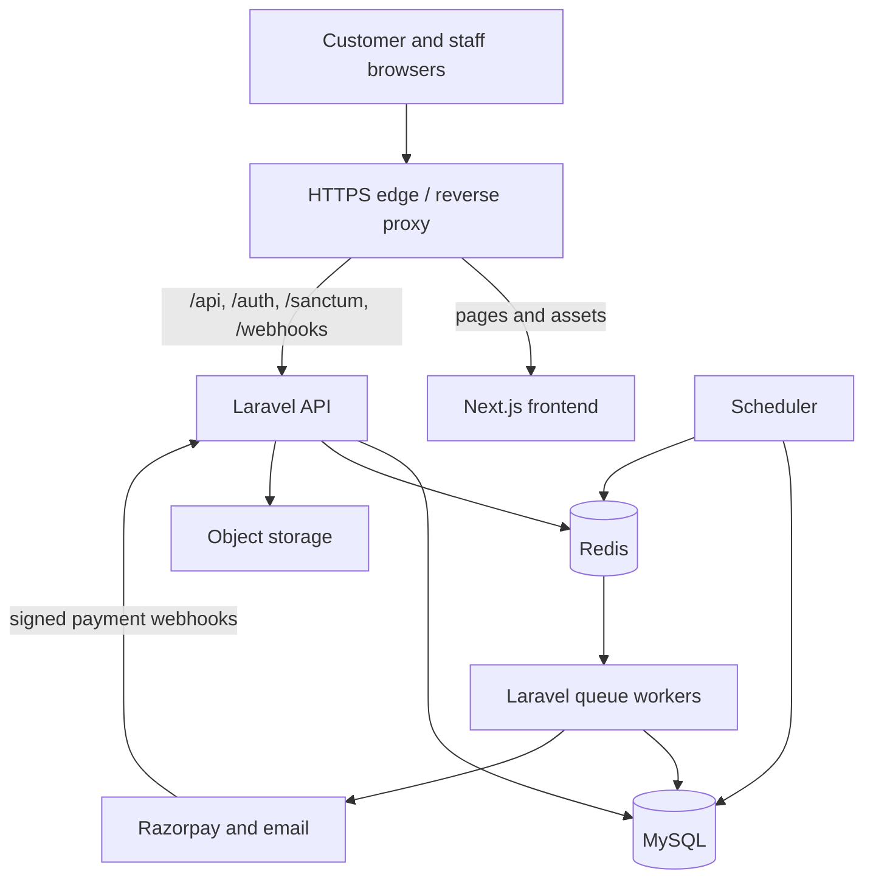
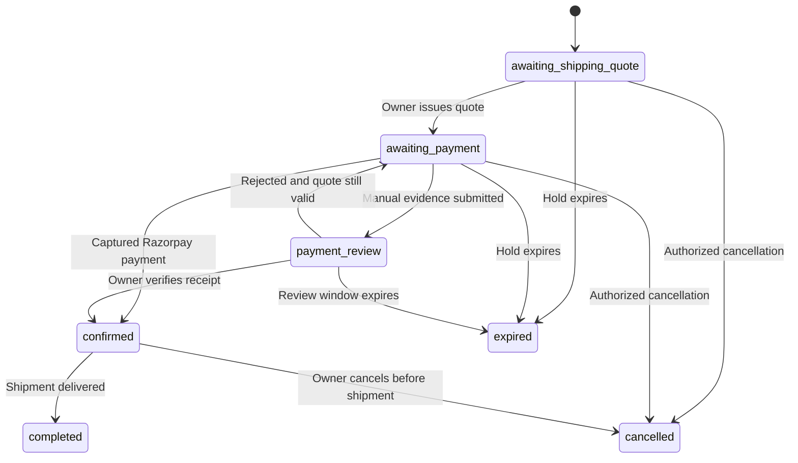

# Auraflare - complete implementation plan for Codex

Version 1.1 | 19 October 2026 | Production implementation specification, not implemented code

## 1. How to use this document

This is the execution plan for building the complete Auraflare application: public candle storefront, customer accounts and guest checkout, Laravel API, owner/staff admin, inventory, payment verification, fulfillment, enquiries, content and team management. It expands the earlier architecture blueprint with implementation work units, coding conventions, dependency order, acceptance evidence and resumption instructions.

Recommended input: extract `Auraflare-Codex-Implementation-Kit.zip` into the working repository or make its folder available to Codex. It includes this plan, the original machine-readable contract, supporting specifications and both original design-reference ZIPs. Tell Codex where it is located. The plan is also delivered separately for easy reading. The API appendices below make it understandable independently; use the included `contracts/openapi.yaml` for actual code generation.

Reading order: master prompt below; confirmed requirements; coding patterns; implementation work units; included architecture/API/release specifications; endpoint and schema appendices. The existing PDF is a reading reference; source Markdown and OpenAPI are better inputs for implementation.

This task creates a plan. It does not create a GitHub repository, implement the application, deploy a site, send customer messages or initiate payments.

## 2. Master prompt - paste into Codex

```text
Act as the principal engineer implementing Auraflare, a candle commerce application.

Implement the complete application described in Auraflare-Codex-Complete-Implementation-Plan.md and the accompanying contracts/openapi.yaml. Read this plan, repository AGENTS.md if present, architecture/API/release specifications and both supplied design-reference ZIPs before editing production code. The customer has confirmed a greenfield build from design prototypes; inspect the actual repository and preserve any valid work already present.

Use one monorepo: apps/api is a Laravel modular monolith; apps/web is a Next.js/TypeScript storefront and admin application; packages/api-client is generated from the contract. Use MySQL, Redis, object storage, session authentication and server-side permissions. Adopt the coding patterns and financial/stock invariants in this plan. Select compatible supported package versions, pin them, and record the choices.

Work through M0-M6 in dependency order using the work units and acceptance criteria. Complete each work unit, run the relevant checks, update docs/implementation/STATUS.md and continue to the next unblocked unit. Do not stop after scaffolding, mock UI, a backend-only slice, or M0. Do not ask for routine milestone confirmations. Report concise progress while working.

Confirmed checkout: customer submits an order request; ready stock is reserved; owner confirms shipping charges; customer accepts the final quote; payment is through Razorpay or manual payment verified by the owner; verified payment enables fulfillment. Guests and optional accounts are supported. INR and selected Indian delivery regions only. No made-to-order sales or COD.

Keep business rules in Actions, inputs in Form Requests/DTOs, resource authorization in Policies, JSON output in API Resources, complex reads in query objects, and integrations behind small adapters. Order/payment transitions are explicit commands. Avoid generic services/repositories for every model. Critical stock/payment effects must be transactional, idempotent and tested against MySQL.

Use the original HTML/CSS/assets as visual references, including premium wine/ivory/champagne styling, rounded image covers, sticky navigation, restrained accessible motion, admin login/team/profile and mobile content-preview fixes. Replace every simulated authentication/order/payment/storage interaction with real persistence and truthful API states. Do not import illustrative catalogue data as business facts.

Do not invent delivery areas, tax rates, bank details, payment secrets, shipping/return policies or real product specifications. Document missing business inputs and keep the affected production feature disabled. Continue other work using clearly synthetic fixtures, local mail capture, provider fakes and Razorpay test mode where credentials are available. Missing live credentials must not block building a testable integration, but live acceptance remains explicitly blocked.

M0 must validate the proposed OpenAPI contract using full tooling, resolve recorded schema/semantic questions, generate the TypeScript client and freeze the accepted baseline. Keep implementation and contract synchronized in every later change. Build browser mocks from the contract, then replace them with real integrated APIs. Never count mock success as integration evidence.

Respect existing Git workflow. Use a feature branch when possible; do not discard unrelated changes. Make reviewable local commits if the repository workflow permits. Do not create/push remote repositories, publish, deploy, send real invitations/transactional messages or perform real charges without explicit authorization. Local mail previews and test-mode integrations are allowed development work. Do not spawn subagents unless the user or repository instructions explicitly authorize them.

Before finishing, run the relevant API, MySQL concurrency, contract, TypeScript, build and browser checks. Record exact results and limits. Deliver working functionality, setup/migration instructions, final status, unresolved configuration and remaining launch gates. Never claim a launch is complete because code compiles or tests use provider fakes.
```

## 3. Confirmed product requirements

| Area | Required behaviour |
|---|---|
| Brand | Auraflare; approved premium dark wine storefront and coordinated admin |
| Starting point | Production code starts fresh; two prototypes are visual references |
| Storefront | Catalogue, collections, product details, variants, cart, request checkout, story/care content and event enquiries |
| Accounts | Guest checkout plus optional customer accounts; secure order access and tracking |
| Delivery | Selected Indian cities/states; configurable eligibility; owner confirms shipping charge before payment |
| Currency | INR, integer paise in storage/API |
| Stock | Ready stock only; prevent overselling and purchases of unavailable stock |
| Payment | Razorpay plus manual payment requiring owner verification |
| Admin | Products/photos/prices/collections, orders/payments/shipping, inventory/alerts, content/enquiries |
| Access | Owner and fulfillment staff; server-enforced permission differences |
| Team/profile | Secure invitations, role/deactivation handling, profile/avatar/password changes; protect final owner |
| Login | Blank credentials, no default selected user or role picker, real authentication |
| Launch scope | One store and one inventory location assumed; no international sales/COD/made-to-order |

Proposed defaults still requiring business review: email/password customer login, transactional email provider, hold windows, shipping review SLA, full-order refunds only, tax/invoice configuration and privacy/retention settings. See the source specification for exact proposed defaults. Implement configurability without inventing actual production values.

## 4. Coding patterns - required implementation conventions

### 4.1 Modular monolith

Group code by business ownership inside one Laravel application. Modules share the database and transaction mechanism; they are code boundaries, not separate network services. Commerce coordinates Catalog, Inventory and Payments through explicit actions. Keep integrations in their owning module. Register module routes, policies, factories and providers explicitly.

Modules: Identity, Catalog, Inventory, Commerce, Payments, Fulfillment, Delivery, Content, Enquiries, Media and Reporting. Support primitives: Money, Clock, Audit, Idempotency and Outbox. Do not build module infrastructure beyond the concrete needs of these features.

### 4.2 Request-to-response responsibilities

| Component | Owns | Must not own |
|---|---|---|
| Middleware | Session, CSRF, active staff, request ID, coarse access | Pricing or stock mutation |
| Form Request | Input shape, format and safe field validation | Durable business side effects |
| Policy/Gate | Actor capability and resource access | UI-only role checks |
| DTO | Typed application input; no HTTP dependency | Eloquent persistence or hidden queries |
| Controller | Authorize/map input/call action/return resource | Long checkout or payment orchestration |
| Action | Business state checks, orchestration, transaction boundary | HTML rendering and hidden provider calls under DB locks |
| Model | Relationships, casts, scopes and small invariant helpers | All application workflow in observers |
| Query object | Filtered reads, joins, projections and pagination | Stock/payment state changes |
| API Resource | Stable allowed response fields | Exposing all model attributes automatically |
| Adapter | Provider request/response mapping, timeouts and typed failures | Deciding customer permissions |
| Job | Retryable asynchronous execution of explicit use case | Assuming one delivery or one execution |
| Outbox handler | Deliver persisted side-effect intent after commit | Changing paid state based on notification success |

Policies enforce user capability; Actions re-check current business state under lock. Non-HTTP callers must enforce authorization using an explicit actor/application boundary, rather than bypassing security because they do not use a controller.

### 4.3 Controller example

The following illustrates responsibility separation. DTO/action/resource names must match the implemented contract. It is not a standalone complete endpoint implementation.

```php
public function store(
    IssueShippingQuoteRequest $request,
    Order $order,
    IssueShippingQuote $action,
): OrderResource {
    Gate::authorize('issueShippingQuote', $order);

    $updatedOrder = $action->execute(
        order: $order,
        data: ShippingQuoteData::fromArray($request->validated()),
        actor: $request->user(),
    );

    return new OrderResource($updatedOrder);
}
```

`IssueShippingQuote` must atomically check actor access, current order version/state, active reservation and unresolved payment attempts; calculate the authoritative total; create a quote revision; supersede the previous eligible revision; update order/version/deadlines; append audit/outbox records; and commit. No gateway or email HTTP call belongs inside this transaction.

### 4.4 Action catalogue

| Module | Representative actions |
|---|---|
| Identity | RegisterCustomer, AcceptStaffInvitation, UpdateProfile, ChangePassword, ChangeStaffMembership |
| Catalog | CreateProduct, UpdateProduct, CreateVariant, UpdateVariant, UpdateCollectionMembership |
| Inventory | ReserveOrderStock, ConsumeReservation, ReleaseReservation, AdjustInventory |
| Commerce | SubmitOrderRequest, CreateDirectOrder, IssueShippingQuote, ExtendReservation, CancelOrder, ClaimGuestOrder |
| Payments | CreateRazorpayAttempt, VerifyCheckoutPayment, IngestRazorpayWebhook, SettleOrderPayment, SubmitManualEvidence, ApproveManualPayment, RejectManualPayment, RequestRefund, ReconcilePayment |
| Fulfillment | BeginPacking, DispatchOrder, RecordDelivery |
| Media | UploadMedia, ProcessImage, AuthorizePrivateDownload, CleanOrphanMedia |
| Content | SaveHomeDraft, PublishHomeContent |
| Enquiries | SubmitEnquiry, AssignEnquiry, ChangeEnquiryStatus, AddEnquiryNote |
| Reporting | GenerateOrderExport; read-only DashboardQuery and OrderListQuery |

Use one class per meaningful operation. Small CRUD operations can remain simple; do not create several pass-through layers for a field update. Shared actions participate in the caller's transaction; orchestration must define one consistent lock order.

### 4.5 State, integrations and asynchronous effects

Use backed enums plus explicit transition actions for order/payment/fulfillment states. Return allowed_actions for UI convenience and re-evaluate rules on every command. Do not accept an arbitrary client-supplied status as a substitute for business actions.

Introduce a small RazorpayGateway interface and adapter. Manual bank verification is a separate workflow, not a fake implementation of a gateway charge method. Both verified outcomes call the common settlement action. Use a Strategy only when multiple actual algorithms require it; delivery is a configured allowlist and owner quotation in v1.

Persist side-effect intent in an outbox in the same transaction as the business change. Workers deliver after commit with deduplicated effect keys. afterCommit dispatch alone does not close the crash window between a committed transaction and job dispatch; the outbox sweeper is the recovery mechanism.

### 4.6 Eloquent and query design

Use Eloquent in Actions and dedicated query classes. No mandatory BaseRepository, BaseService or interface for every model. Scope reads to principal/resource ownership; allowlist sort/filter fields; eager-load required relations and measure query count. Public projections use explicit resources. Raw SQL is acceptable for proven critical queries with parameter binding and tests.

Use typed properties, explicit return types, immutable input DTOs where appropriate and integer Money values. Do not pass the HTTP Request into a domain action. Use an injectable clock or framework time controls for expiry tests. Avoid hidden static mutable state and cross-request singletons holding user data.

### 4.7 Frontend conventions

One Next.js application with storefront/auth/admin route groups; feature folders own API hooks, forms, validation and view components. Server components fetch only safe public data by default. Interactive cart/checkout/admin pages use client components and typed API access. Private requests use no-store and a correctly scoped session. Do not cache account/order data in a public server/CDN cache.

Use the generated API client, one consistent query-cache/form approach selected in M0, and design tokens from the approved references. Keep canonical prices, stock, permission and payment facts on the backend. Optimistic UI is suitable for reversible low-risk edits only; paid, published and dispatched states wait for authoritative results. Persist no passwords, session tokens, proof files or private addresses in browser localStorage.

## 5. Repository and implementation records

The exact proposed tree is in the architecture specification later in this document. Add these implementation records from M0:

```text
docs/implementation/
  STATUS.md
  DECISIONS.md
  CONFIGURATION-CHECKLIST.md
  ACCEPTANCE-EVIDENCE.md
  CONTRACT-QUESTIONS.md
  CONTRACT-CHANGELOG.md
  LAUNCH-CHECKLIST.md
  runbooks/
    payments-and-refunds.md
    webhook-replay.md
    stock-and-expiry.md
    backup-restore.md
    deploy-rollback.md
```

`STATUS.md` tracks work-unit ID, state, completed behaviour, checks, next task and actual blocker. Allowed states: not_started, in_progress, implemented_unverified, verified, blocked. A unit with missing browser/provider checks is not verified. Record commit IDs when available, never invent them. Resume from this file and current repository state rather than restarting completed work.

## 6. Milestone work units

Every work unit includes backend/frontend/docs/tests needed for that slice. Do not claim a unit complete while it still uses demo authentication, local-only business persistence or simulated success. Keep mocks development-only and label them.

### M0 - foundation and contract qualification

**M0.1 Inspect and establish the repository.** Inspect AGENTS.md, Git state and supplied references. Create the monorepo structure, root README, workspace setup, .env.example and non-root containers. Use the current supported compatible dependency set, pin lockfiles and add Make targets for setup/dev/lint/test/build. Preserve unrelated existing changes. One application DB only.

**M0.2 Establish runtime and deployment shape.** Implement same-origin routing for Next.js pages and Laravel /api, /auth, /sanctum and /webhooks paths; configure local host names, database, Redis, worker, scheduler, mail capture and storage. Implement liveness and readiness separately. Default local payments to fake/test mode; production checkout off until configured.

**M0.3 Qualify the API contract.** Run a full OpenAPI validator, check all operation IDs, schema nullability and client compatibility, generate TypeScript types/client, compile a minimal consumer and validate examples. Ensure each of the 100 baseline operations maps to a tracked work unit. Resolve issues below before freezing; document changes instead of copying an invalid contract unchanged.

Contract review checklist:

- Nullable schema references must validate and generate correct client types, especially Order.current_quote and AdminOrder.shipment.
- Confirm actual cookie names, CSRF behaviour, route prefix/proxy forwarding and guest grant scope.
- DELETE requests with JSON bodies (cart removal/image detach) need browser/proxy support; prefer a version header/query or explicit command if required and update client/spec together.
- Define whether invitation acceptance is a new-user setup or authenticated existing-user acceptance; schema and server must require the proper name/password/verified-email path. Token-only acceptance cannot set arbitrary new credentials or bypass invited-email control.
- Restrict allowed ownership of media and request-body purpose/order_id combinations; private proof URLs remain null in public media responses.
- Financial/date fields, partial PATCH validation, empty item arrays and property unknown-field handling must match implementation.
- Quote/payment creation must expose truthful pending/unknown responses and polling information; enum states cannot regress under out-of-order delivery.
- Standardize admin versus customer Order response shape per operation. Existing guide examples that show a safe subset are illustrative; integration responses must match the frozen schema.
- The baseline reuses operational order data for staff; explicitly prevent raw payment/bank evidence/provider secrets from leaking to fulfillment staff. Owner-only finance fields may need distinct projections.
- Dashboard totals must permit negative net receipts during a refund-heavy period. Define timezone/bounds and maximum reporting range.

**M0.4 Establish CI and coding standards.** Add formatting/static analysis/test/build jobs and contract checks. Add synthetic factories/fixtures and contract-driven browser mocks. Create implementation records and business config gates. Generate a migration dependency checklist and an API-to-screen coverage matrix.

Exit evidence: clean setup; correct routing/session bootstrap; generated client compiles; full contract validation passes; package versions and unresolved business settings recorded; CI baseline green.

### M1 - identity, permissions and profile

**M1.1 Identity persistence and session flows.** Users, staff memberships, sessions, password reset/verification/invitation records; customer registration, login/logout and recovery; unique normalized emails and configured password rules. Password hashing through Laravel. First owner via CLI, never seed known production passwords.

**M1.2 Authorization.** Active-staff middleware, owner/fulfillment policies, own-resource customer access, verified account claiming boundary. Prevent customers from assigning roles. Lock final-owner membership changes and revoke sessions on deactivation. Define explicit actor context for guest/business actions.

**M1.3 Team and profile UI/API.** Login/recovery/register screens, customer account shell, owner team invite/list/role/deactivate, invitation acceptance, profile/name/phone/bio, email change verification, avatar upload/removal and password change verifying current password. Avatar processing can use the Media slice's initial implementation.

Exit evidence: permission matrix API tests, invitation replay/wrong-email tests, recovery anti-enumeration, final-owner race test, session revocation, password and upload rules; browser checks for login/team/profile. Outgoing messages are inspectable in local mail capture.

### M2 - media, catalogue, stock and delivery

**M2.1 Media primitives.** Upload storage records, purpose policy, ready/processing/rejected states, bounded image processing, private proof storage, validation/metadata stripping and orphan cleanup. Product/media ownership is server-enforced. Implement private proof scanning before proof access is enabled.

**M2.2 Catalogue models/actions/admin.** Products, variants/options, collections/membership, media associations, prices and archive states. Staff can read operational catalogue; owners edit. Activate products only when required real catalogue fields/media/active variants satisfy validation. Fixtures remain synthetic and isolated from production seeding.

**M2.3 Inventory.** Balances, reservation foundations, immutable movement ledger, adjustments with reason, thresholds/alerts and concurrency-safe updates. Create default zero inventory for new variants; do not expose arbitrary absolute stock PATCH. Handle inactive/archived variant changes while orders hold snapshots.

**M2.4 Delivery eligibility.** Admin state/city/postcode allowlist and explicit deny precedence; validate canonical location data. Initial policy: an explicit postcode deny wins; otherwise postcode allow, then configured city match within state, then state allow; no applicable allow means unavailable. Validate the final precedence with business before launch and document it. Changes apply to new requests; existing requests retain their serviceability policy snapshot and require owner review if fulfillment becomes impossible.

**M2.5 Public storefront.** Port approved references into real components: home, collections, sorting/filtering, product details/variant selection, images and care/story/FAQ sections; public SEO metadata, sitemap/indexable routes and real empty states. Keep demo catalogue out of production. Restore accessible modal/focus/keyboard behaviour and motion preferences.

Exit evidence: owner/staff restrictions; variant uniqueness; media validation/ownership; stock adjustment invariants; delivery deny/allow cases; SSR public projections contain no private data; mobile/desktop catalogue and admin forms verified.

### M3 - cart, order requests, guest access and shipping quote

**M3.1 Cart and accounts.** Session-owned guest/account carts, item mutation/versioning and deterministic login merge. Reprice on backend; cart creates no hold. Own address-book CRUD. UI displays fresh quantities/prices and handles stock/price conflicts.

**M3.2 Submission and direct orders.** Create snapshots, check configured tax/serviceability, aggregate duplicate lines, reserve all variants atomically, persist audit/idempotency/outbox and clear or mark submitted cart only after success. Support direct WhatsApp/Instagram/phone orders through the same price/stock actions; do not accept price overrides. Implement order request screens and admin detail/list.

**M3.3 Guest access and account linking.** Order-scoped HttpOnly grant, one-time email token exchange, generic access-link recovery, expiry/revocation and explicit verified customer claim. Separate cart capability from order capability in server records even when one guest cookie stores the session identifier. Invalid order ID is never sufficient access. Tracking/order pages are noindex/no-store.

**M3.4 Quote issuance and expiry.** Owner shipping quotes, immutable revision/acceptance, payment deadlines, reservation expiry/extension, unpaid cancellation and outbox notifications. Show final breakdown/deadline before customer acceptance. No payment attempt without current accepted quote. Address/items are immutable after submission; cancel/recreate while eligible.

Exit evidence: last-unit race; duplicate-submit idempotency; price-change conflict; stock rollback when one line fails; guest isolation/replay/claim tests; superseded/expired quote checks; expiry/cancel races; manual quote UI and direct-order integration.

### M4 - payments, settlement, exceptions and refunds

**M4.1 Provider boundary.** Razorpay adapter and test fake, typed timeout/failure handling, immutable internal attempts, provider order creation outside DB locks and unknown-result recovery. API Idempotency-Key does not make external calls exactly-once. Reconcile ambiguous create/payment/refund responses before retrying an external operation.

**M4.2 Verification/inbox/reconciliation.** Raw-body webhook verification, provider-event unique key, durable inbox before ACK, worker replay and bounded retries; browser signature verification plus provider capture/order/amount/currency checks; scheduled reconciliation of pending/unknown and refund records. Share one settlement action across paths. Unknown event type is safely recorded/ignored.

**M4.3 Manual payment.** Configured instructions, accepted-quote evidence submission, private attachments, reference normalization, owner review queue, verify/reject actions with audit. Independently confirmed received funds and correct amount are required. Duplicate bank references cannot settle multiple orders. A proof screenshot does not prove payment.

**M4.4 Settlement and exceptional paths.** Under consistent locks, consume reservation and mark paid once. Reject duplicate stock/financial effects with DB uniqueness. Late capture, duplicate capture or stale quote money is an exception with an owner action queue; preserve provider facts and prevent auto-shipping. Hold expiry cannot erase the fact that payment was received.

**M4.5 Refunds.** Full-order refund request, provider/manual transfer confirmation, reconciliation after timeouts and audited eligible restock as a separate operation. Refund status must reflect real outcome. Enforce refundable balance and no duplicate restock. No partial-refund/partial-shipment scope expansion.

**M4.6 Payment UI.** Checkout success/pending/failure/expired pages, polling/resume after browser refresh, current quote acceptance, Razorpay widget, manual instructions/upload/review status, owner exceptions/refunds controls. Do not display paid based on client callback alone. Prevent method switching while unresolved attempt exists.

Exit evidence: callback/webhook races, duplicate/out-of-order events, wrong signature/amount/currency/order, authorized-not-captured, timeout after success, crash recovery, late payment after hold release, duplicate capture, manual approval races, full refunds and private evidence isolation. Integration fakes plus test-mode account evidence are distinguished; live credentials are a launch gate.

### M5 - fulfillment, operations, content and reporting

**M5.1 Fulfillment.** Paid-only packing/dispatch/delivery; one shipment/order, manual carrier/tracking; optimistic order version checks and idempotent commands. Staff cannot change prices/quote charges/financial verification. Customer order page displays safe fulfillment history and tracking.

**M5.2 Enquiries.** Website/event intake, direct-channel admin creation, list/filter/detail, assignment/status/internal notes. No message-sending UI unless an authorized communication workflow is implemented. Customer sees submission acknowledgement, never internal notes.

**M5.3 Content management.** Typed content blocks, owner draft/save/preview/publish, validated media/collection references, atomic published pointer and public cache invalidation with TTL fallback. Mobile preview grows with long copy. Drafts remain private and noindex.

**M5.4 Reporting, exports and audit.** Real operational overview; owner-only financial totals, explicit IST period semantics and refund treatment; paginated audit history; asynchronous private formula-safe CSV exports with expiry. Low-stock and overdue quote/manual-review work are actionable.

Exit evidence: unpaid ship rejection; duplicate dispatch; real enquiry persistence/assignment; draft isolation; publish freshness; role-specific dashboard data; report midnight/refund cases; export authorization/formula handling; responsive end-to-end admin checks.

### M6 - qualification, operational readiness and delivery

**M6.1 Complete the coverage matrix.** Every frozen API operation has its permission check, implementation location, automated coverage and screen/consumer. Every visible UI action has real backend behaviour or an accurate unavailable state. Regenerate client and assert clean diff. Verify frozen examples against runtime resources.

**M6.2 Browser and accessibility.** Run critical guest/account/direct-order and owner/staff paths. Check 320, 360, 390, 430, 768, 1024 and 1440 px, long text, keyboard/focus and reduced motion. Verify intro skip/Escape/replay, sticky navbar, image cropping and no overflow. Measure performance on a throttled mobile profile and record actual results.

**M6.3 Operational readiness.** Supervised workers, scheduler singleton execution, durable queues/outbox/inbox, alerting, exception queues, backup/restore and migration/rollback rehearsal, private-media controls, production configuration gating, debug-off and secret isolation. Ensure Next.js/API releases and workers use compatible contract versions.

**M6.4 Final implementation handoff.** Produce startup/migration commands, environment checklist, owner bootstrap, provider setup/runbooks, test report, remaining launch inputs and known limits. Provide local commits/reviewable changes according to repo workflow. If remote push/PR/deploy is not authorized, stop at the completed local implementation and explain exactly how to proceed. Do not label deployment or live validation as complete when not performed.

## 7. Migration and dependency order

1. Identity and support records: users, sessions, memberships, invitations, audit, idempotency, outbox.
2. Media storage records; user avatar FK only after media exists, using a later nullable FK migration if needed.
3. Catalog products/variants/options/collections; product image associations after both media and products exist.
4. Inventory balances and movements; reservation order FK added after orders exist or create reservations in step 6.
5. Delivery policy and content revisions; published media/collection references must exist.
6. Carts, orders, order items, shipping quotes, stock reservations and reservation items.
7. Payment attempts/evidence/refunds/webhook inbox; use staged FK additions for optional cross-references.
8. Shipments, enquiries/notes, export/notification-delivery records and reporting indexes.

Use unique Laravel migration timestamps and explicit indexes/FKs. Test migrate:fresh with synthetic data and forward upgrade on a representative staging schema. Review foreign-key delete behaviour; never cascade-delete settled order/payment history. Financial snapshots are immutable; historical totals do not change when a product price changes.

## 8. Non-negotiable correctness rules

- Available stock = on_hand - reserved; nonnegative and never greater than physical stock. No made-to-order fallback.
- All stock-affecting paths follow the same documented lock order. MySQL integration tests prove races, not SQLite mocks.
- Order submission reserves all lines or none. Cart does not reserve stock.
- Final payable amount is server-calculated from the accepted current quote; shipping pending is null, not zero.
- Payment facts require verified captured/received funds. Authorization, frontend callbacks and screenshots are insufficient.
- Paid/stock effects are deduplicated by permanent business uniqueness, independently of short-lived API retry records.
- A provider timeout is not proof of failure. Persist unknown state, reconcile and prevent blind second payment creation.
- Order, payment and fulfillment states are separate; named actions enforce allowed transitions.
- External calls occur outside DB locks. Notifications cannot roll back a valid payment or grant paid status.
- Owner/staff/customer/guest authorization is enforced server-side; IDs, hidden buttons and route names are not security.
- Guest access is order-scoped, expiring and revocable. Customer account association requires verified control and explicit claim.
- Production configuration is truthful. Unconfigured delivery/tax/manual payment live settings disable affected operations instead of inventing values.

## 9. Testing and completion evidence

Run the relevant checks at each work-unit boundary; run the full critical suite at integration/release boundaries. Do not repeatedly rerun unchanged broad suites without a new reason. API permission/ownership tests cover every protected operation. Include real MySQL concurrency tests for reservation, expiry/payment, inventory adjustment and final-owner membership changes.

Minimum browser journeys:

1. Guest browses/selects variant, submits request, receives owner quote, accepts and completes Razorpay test payment, sees dispatch/delivery.
2. Guest manual payment stays under review until owner verification; rejection and retry preserve history.
3. Customer registers/verifies, merges cart, manages address, claims eligible guest order and views own history.
4. Owner creates/activates product/variant/photos, adjusts stock, quotes order, reviews manual payment, publishes content and invites staff.
5. Fulfillment staff packs/ships/manages enquiries but cannot edit pricing, quote shipping, approve money, publish content or manage team.
6. Recovery: browser refresh pending payment, expired hold, superseded quote, webhook retry/queue outage, duplicate submit and incorrect guest grant.

Completion report must separate: implemented, automated verification passed, manual/browser verified, provider test-mode verified, blocked/unverified, and live launch pending. Include exact check counts only from actual output. Do not equate this plan's 100 endpoint definitions with 100 tested implemented endpoints.

## 10. Configuration questions that do not block independent development

| Input | Needed before | Development treatment |
|---|---|---|
| Actual products/SKUs/options/prices/photos/stock | Catalogue launch | Clearly synthetic fixtures; preserve supplied photos as design assets only until confirmed |
| Exact serviceability allowlist | Real order intake | Empty production rules fail closed; fixture regions only in development |
| Tax and invoice business policy | Real quote/payment | Versioned policy interface/config with test fixtures; no invented tax rate |
| Razorpay account/test/live credentials and capture/webhook settings | Provider qualification / live payment | Deterministic adapter fake; test mode only with supplied credentials |
| Manual payment destination/payee/instructions | Manual payment enablement | Disabled production method until supplied |
| Email provider/domain/support address | Real customer notifications | Local mail capture and previews |
| Hold deadlines/review SLAs/refund policy | Launch | Configurable proposed defaults documented for owner review |
| Hosting/domain/storage/backups/alerts | Staging and launch | Docker/reference configuration; no assumed purchased infrastructure |

Ask only when a missing answer blocks the next dependent step; keep independent work moving. Real tax/policy decisions belong to the business with appropriate advice, not implementation guesses.

## 11. Continuation prompt

```text
Continue Auraflare from docs/implementation/STATUS.md and the current Git state. Read the master plan and repository instructions. Identify the next unverified work unit, preserve completed work, implement remaining authorised tasks and run relevant checks. Continue through unblocked units; do not restart the scaffold or stop at a mock implementation. Keep missing business/live settings gated and record exact verification limits.
```

## 12. Final review prompt

```text
Review the actual Auraflare implementation against the frozen OpenAPI contract, master plan and original design references. Inspect source and tests, not only documentation claims. Trace stock/payment state transitions, guest access, staff boundaries, upload privacy, cache isolation, migrations and retry recovery. Verify each API-to-screen matrix entry. Report defects with concrete files/conditions, distinguish launch blockers from deferred scope, and rerun relevant checks after fixes. Do not deploy or send external messages as part of this review.
```

---

# Included detailed specifications

The following sections reproduce the implementation baseline for standalone reading. The execution instructions and work units above supersede the earlier handoff's instruction to stop after M0: when implementation of the full plan is authorized, continue through unblocked milestones after checks. Confirmed user requirements take precedence. M0 resolves and records inconsistencies before contract freeze.

# Detailed architecture baseline

# Auraflare — Architecture and data design

Version 1.0 • 19 October 2026 • Status: proposed implementation baseline

## 1. Executive decision

Build a Laravel modular monolith with a Next.js/TypeScript frontend in one Git repository. Use one relational database, one inventory authority and one payment orchestration layer. Next.js serves the public storefront and protected admin route groups; Laravel owns authentication, authorization, catalogue, stock, orders, pricing, payments and publishing. Deploy the frontend and API independently from the same reviewed commit. Do not introduce microservices, Kubernetes, a generic repository layer, event sourcing, GraphQL or multiple databases for this launch.

Laravel 13 + PHP 8.5 is the proposed greenfield baseline. Laravel's published support table lists PHP 8.3–8.5 for Laravel 13. Confirm all selected package versions in M0 and commit Composer and JavaScript lockfiles. Use MySQL and Redis on maintained releases compatible with the chosen hosting; pin exact container versions/digests in M0. Next.js App Router supports indexable product/collection pages; use client components for the cart, dialogs, checkout, payment widget and admin. Do not add a second React/Vite app until independent admin deployment provides a concrete benefit.

## 2. Confirmed scope versus proposed defaults

| Topic | Decision | Status |
|---|---|---|
| Existing application | Design prototypes only; build production application fresh | Confirmed |
| Geography/currency | Selected Indian cities/states; INR | Confirmed; exact delivery list pending |
| Customer access | Guest checkout plus optional accounts | Confirmed |
| Shipping | Owner confirms delivery charges before requesting payment | Confirmed |
| Payments | Razorpay and manual payment with owner verification | Confirmed |
| Availability | Ready stock only; no purchase when sold out | Confirmed |
| Roles | Owners and staff with different permissions | Confirmed in design brief |
| Operations | Catalogue, photos, variants, stock alerts, orders, shipping, enquiries, content, team, profile/password/avatar | Confirmed in design reference |
| Deployment | One monorepo, two deployable apps; same-origin routing | Proposed |
| Customer login | Email/password, verified email; no SMS OTP in v1 | Proposed |
| Order communications | Transactional email; manual channels can share secure payment page | Proposed; provider pending |
| Review/payment holds | 24h review; 24h payment window from quote; 48h manual-review window from submission | Proposed configurable defaults |
| Tax | Versioned server-side tax policy; actual registrations/rates/invoice wording must be supplied | Unresolved launch input |
| Shipping/returns/refunds | Manual shipment entries; full-order refunds first; no automated courier integration | Proposed v1 scope |

The reviewed ZIP snapshots contain illustrative catalogue records and simulated authentication/checkout. Never import sample prices, inventory, claims or customer records as real business data. Latest font refinements after the exported storefront snapshot may need separate visual confirmation; this plan does not change the design.

## 3. Deployment topology



Use an owned domain with host-only secure session cookies. Example routing is conceptual, not an existing domain: `https://shop.example.test` serves pages including `/admin`; edge sends Laravel prefixes to PHP-FPM/Nginx. Deploy the same routing model locally and in staging. CDN/cache bypass all authentication, cart, order, admin and payment endpoints. Only public catalogue/content may be cached. An admin URL is not a security boundary: Laravel checks staff membership and permissions on every request.

Use one API service image for HTTP, queue workers and scheduled tasks, with separate processes. Start with one appropriately sized host or managed services; size from measured traffic, not invented volume. Persist the database and uploads outside containers; use managed backups or an equivalent tested backup process.

## 4. Laravel module boundaries

| Module | Owns | Dependencies |
|---|---|---|
| Identity | Users, verification, sessions, invitations, staff membership, capabilities, profiles | Media for avatars; Notifications |
| Catalog | Products, variant SKUs/options, prices, collections, public projections | Media |
| Inventory | Balances, holds, immutable movement ledger, low-stock thresholds | Catalog identifiers |
| Commerce | Carts, order requests, order snapshots, shipping quotes, transitions | Catalog, Inventory, Delivery, Tax |
| Payments | Attempts, Razorpay orders, webhook inbox, manual evidence, refunds, reconciliation | Commerce public actions; provider adapter |
| Fulfillment | Packing, shipment and delivery records | Paid Commerce orders |
| Delivery | Serviceability rules and explicit postcode exceptions | No external courier in v1 |
| Content | Draft/published home content and revisions | Catalog, Media |
| Enquiries | Public enquiries, source, notes, assigned staff, status | Identity identifiers |
| Media | Upload validation, private proofs, public product images and derivatives | Object storage |
| Reporting | Dashboard projections and export jobs | Read-only queries across modules |
| Audit/Notifications | Audit records; transactional outbox and delivery records | Cross-cutting primitives |

Keep controllers thin: FormRequest → authorization policy → typed DTO → action → API Resource. An action represents one business use case (`IssueShippingQuote`, `VerifyManualPayment`). Use Eloquent directly in actions/query objects; add interfaces only at replaceable boundaries such as Razorpay, mail and storage. Write explicit orchestrating actions for cross-module transactions. Do not hide stock mutation in model observers. Domain events describe completed outcomes and run side effects after commit through an outbox.

## 5. Repository and directory structure

```text
auraflare/
  AGENTS.md
  README.md
  Makefile
  compose.yaml
  .github/workflows/{api,web,contract,release}.yml
  apps/
    api/
      app/
        Modules/
          Identity/{Actions,Data,Enums,Models,Policies,Http,Jobs}/
          Catalog/{Actions,Data,Enums,Models,Policies,Queries,Http}/
          Inventory/{Actions,Data,Enums,Models,Policies,Jobs,Http}/
          Commerce/
            Actions/{SubmitOrderRequest,IssueShippingQuote,CancelOrder}.php
            Data/{SubmitOrderData,OrderLineData,ShippingQuoteData}.php
            Enums/{OrderStatus,PaymentStatus,FulfillmentStatus}.php
            Models/{Cart,CartItem,Order,OrderItem,ShippingQuote}.php
            Policies/OrderPolicy.php
            Queries/OrderListQuery.php
            Http/
              Controllers/{Storefront,Admin}/
              Requests/{SubmitOrderRequest,IssueShippingQuoteRequest}.php
              Resources/{OrderResource,OrderSummaryResource}.php
          Payments/{Actions,Contracts,Data,Enums,Models,Jobs,Http,Providers}/
          Fulfillment/{Actions,Models,Policies,Http}/
          Delivery/{Actions,Models,Http}/
          Content/{Actions,Models,Policies,Http}/
          Enquiries/{Actions,Models,Policies,Http}/
          Media/{Actions,Models,Policies,Http}/
          Reporting/{Queries,Jobs,Http}/
        Support/{Money,Clock,Idempotency,Audit,Outbox}/
        Providers/{AppServiceProvider,ModuleServiceProvider}.php
      bootstrap/app.php
      routes/{api,auth,webhooks,console}.php
      config/{auraflare,payments,inventory,delivery}.php
      database/{migrations,factories,seeders}/
      tests/{Unit,Feature,Integration,Contract}/
      composer.json
      composer.lock
      Dockerfile
    web/
      src/
        app/
          (storefront)/{page,layout}.tsx
          (storefront)/products/[slug]/page.tsx
          (storefront)/collections/[slug]/page.tsx
          (storefront)/{cart,checkout,account}/
          (storefront)/orders/[orderId]/page.tsx
          (auth)/{login,register,forgot-password,reset-password}/
          admin/{layout,page}.tsx
          admin/{orders,products,inventory,enquiries,content,team,profile}/
        features/{catalog,cart,checkout,orders,payments,auth,admin}/
        components/{ui,brand,forms}/
        lib/{api,auth,query,money,validation}/
        styles/{tokens,globals}.css
        mocks/{handlers,fixtures}/
      public/
      tests/{unit,e2e}/
      package.json
      Dockerfile
  packages/
    api-client/{src,package.json}/
    design-tokens/
  contracts/{openapi.yaml,examples}/
  docs/{architecture,decisions,runbooks}/
  design-reference/{README.md}/
  infrastructure/{nginx,containers,deploy}/
  package.json
  pnpm-workspace.yaml
  pnpm-lock.yaml
```

These paths are proposed files, not existing application code. Create module subfolders only when used. Register route files, policy mappings, model factories and providers explicitly so nonstandard model paths work. Keep migrations in Laravel's normal central folder with globally unique timestamps. `packages/api-client` is generated from `contracts/openapi.yaml`; never hand-edit generated types. Do not create an npm backend wrapper; PHP dependencies remain Composer-owned. Use a simple pnpm workspace; add task orchestration only if build time warrants it.

## 6. Core relational model

Use internal bigint primary keys and unique ULID `public_id` values exposed as API IDs. FK columns use internal keys. This is a proposal chosen for straightforward Laravel/MySQL support, not a requirement to use binary UUIDs. Store UTC timestamps; render/report in Asia/Kolkata. All monetary values are integer paise, currency fixed to INR. Never use floating point for totals.

| Tables | Key data and constraints |
|---|---|
| users | public_id, unique normalized email, password hash, email_verified_at, name, phone, bio, avatar_media_id, active |
| staff_memberships | unique user_id, role owner/fulfillment, active; optional explicit approved capabilities later |
| invitations | normalized email, role, token_hash, expires_at, accepted_at, invited_by; no plaintext token |
| sessions / password_reset_tokens | Laravel session and recovery persistence |
| customer_addresses | user_id, address fields; authorization scoped to owner |
| products | public_id, unique slug, title, description, scent_notes, status draft/active/archived, version |
| product_variants | product_id, unique SKU, normalized option combination hash unique per product, price_minor, currency, active, version |
| variant_options | variant_id, option_name, option_value; unique (variant_id, option_name) |
| collections / collection_product | collection slug/title/status; unique association and sort position |
| media / product_media | storage key, purpose, owner, MIME, byte size, lifecycle; image association/alt/order |
| inventory_balances | unique variant_id, on_hand, reserved, low_stock_threshold, version; nonnegative, reserved ≤ on_hand |
| stock_reservations / reservation_items | order_id unique reservation; status active/consumed/released, expires_at; quantities per variant |
| inventory_movements | variant_id, signed on_hand_delta, signed reserved_delta, reason, actor/order refs, unique effect_key |
| carts / cart_items | opaque guest cart cookie hash or user_id; cart version; unique (cart_id, variant_id); no stock holds |
| delivery_rules | kind state/city/postcode, canonical location fields, allow/deny, active, priority; postcode deny wins |
| orders | public_id, unique display number, user_id nullable, source website/whatsapp/instagram/phone, contact/address snapshots, status, payment_status, fulfillment_status, subtotal/tax/shipping/total_minor, version, policy snapshots |
| order_items | product/variant refs, SKU/title/options/unit-price/tax snapshots, quantity, line_total_minor; immutable after submission |
| shipping_quotes | order_id, version unique per order, amount_minor, total_minor, expires_at, issued_by, accepted_at, status; one current quote |
| payment_attempts | order_id, quote_id, method, amount/currency, provider_order_id unique nullable, provider_payment_id unique nullable, status, failure_code; multiple attempts per order allowed |
| manual_payment_evidence | attempt_id, reference, evidence_media_id nullable, submitted_at, status, reviewed_by/time, review_reason; normalized bank reference uniqueness when verified |
| refunds | payment_attempt_id, amount_minor, provider_ref unique nullable, state requested/processing/succeeded/failed, reason, idempotency key |
| webhook_events | provider, event_id unique together, payload/raw-body retention, payload_hash, received/processed status, retry metadata |
| shipments | order_id unique in v1, carrier, tracking_number/url, shipped_at, delivered_at, actor |
| enquiries / enquiry_notes | contact/source/product/event details/status/assignee; internal notes separate from public data |
| content_revisions | unique page/revision, schema-versioned JSON blocks, draft/published state, actor and published_at; transactional current pointer |
| audit_logs | actor, action, entity, redacted changes, request_id, created_at; append-only |
| idempotency_records | scope, key, payload_hash, state, response, expires_at; unique(scope,key) |
| outbox_messages / notification_deliveries | business effect key unique, payload, status, retries, sent_at |
| export_jobs | requester, filters, state, private file key, expiry |

Indexes: orders(status, created_at), orders(user_id, created_at), orders(payment_status, created_at); reservations(status, expires_at); variants(product_id, active); products(status, slug); webhook_events(status, received_at); enquiries(status, created_at); payment_attempts(status, updated_at); audit_logs(entity_type, entity_id, created_at). Enforce unique external identifiers and effect keys in the DB, not only application validation.

Archive catalogue entries referenced by orders; do not cascade-delete order/payment history. Soft deletion is not a substitute for retention rules. Separate product public projections from admin records. Never expose procurement notes, proof files, customer addresses or payment payloads through catalogue responses.

## 7. Order request, quote and payment workflow

1. Cart is advisory and never reserves stock. API recalculates current price/availability and serviceability before submission. If a displayed price changed, return `409 PRICE_CHANGED` with a fresh cart; require customer review rather than silently charging a higher price.
2. `Submit order request` creates the order and snapshot lines, reserves stock atomically, and returns `awaiting_shipping_quote`. Show “Delivery charge pending owner confirmation; no payment taken.” The product subtotal is not presented as the final payable amount. Address must fall within configured serviceability rules; missing rules fail closed.
3. Owner reviews the request and issues a versioned shipping quote. Server calculates tax and final total from configured policy. Customer receives a secure page with item subtotal, delivery, tax breakdown, final total and expiry. State becomes `awaiting_payment`. Only the owner may issue financial quotes in v1; fulfillment staff can flag review work.
4. Customer explicitly accepts the current quote as part of payment initiation or manual-payment submission. Store accepted quote version and time. No Razorpay order is created before this step. Address/items cannot be edited after submission; cancel and recreate while unpaid.
5. Razorpay flow creates an internal attempt first, then a provider order outside the DB transaction using the exact accepted total and INR. Browser loads Checkout with provider order and public key. Browser success invokes server verification, which verifies the signature and fetches provider payment details. Only a verified captured payment for the expected provider order/amount/currency can settle the order. Webhook and periodic reconciliation are independent recovery paths.
6. Manual flow displays configured payment instructions after quote acceptance. Customer submits reference and optional private proof; state becomes `under_review`. Only the owner records approval after checking funds against the bank/payment account. A screenshot or customer claim never marks an order paid. Reject with a reason and offer another valid payment attempt if the quote/hold is still current.
7. Settlement consumes the hold: decrease on_hand and reserved by quantity, write one ledger effect and mark paid/confirmed in a single transaction. Packing and shipping are enabled only after settlement. Owner/staff record dispatch and delivery; there is no automated courier integration in v1.



States are separate axes. Order status: `awaiting_shipping_quote, awaiting_payment, payment_review, confirmed, completed, cancelled, expired`. Payment status: `unpaid, pending, under_review, paid, refund_pending, refunded, failed, exception`. Fulfillment: `unfulfilled, packing, shipped, delivered, cancelled`. Return explicit `allowed_actions` based on policy and state. No generic “update status” endpoint; transitions are named commands. A late payment on an expired/cancelled order sets payment status `exception` while retaining the order state and creates an owner task. No automatic fulfillment or silent stock resurrection.

### Holds, race conditions and retries

- Proposed hold deadlines: 24h after request submission; on first quote issue, extend to 24h after issue. Limit one automatic quote extension; subsequent extensions are explicit owner actions with audit reason. Manual evidence within a valid hold extends it to 48h from submission for owner review. These windows require owner review before launch; expose deadlines in the UI.
- On every checkout/reservation command, treat expired holds as expired even if scheduler execution is late. Scheduler sweeps every minute; lazy cleanup on relevant variant rows prevents stale availability. Lock variant balances in sorted ID order, then lock/update order and reservation in a consistent documented order across actions. Retry deadlocks a bounded number of times.
- `available = on_hand - reserved`. Reserve with a transaction and `SELECT ... FOR UPDATE` or conditional atomic update checked for affected rows. Duplicate variant lines must be aggregated before checking stock. Never rely on Redis locks as the only stock correctness mechanism.
- Consume/release effects have unique keys per reservation and effect type. Expiry, cancellation and payment settlement must take the same locks and check current state. Concurrent payment and expiry has exactly one winner; late capture becomes an exception unless an authorized recovery atomically reacquires all required stock.
- Inventory adjustment cannot reduce on_hand below reserved. Record deltas and reason; no bare PATCH to stock quantity. Low stock is computed on available quantity and emits deduplicated alerts on threshold crossings.
- Quote reissue supersedes previous quotes. Do not reprice while a provider attempt or manual review is unresolved; require reconciliation/closure first. An old provider payment is reconciled against its immutable attempt total, then routed to exception handling if quote/order no longer permits settlement.
- Disable payment-method switching while an unresolved attempt exists. Expiry does not make an external gateway incapable of receiving money: reconcile late events. Any excess second captured payment is an owner-visible exception/refund case; never consume stock twice.
- Provider calls occur outside DB locks. A timeout after create-order is an `unknown` attempt; reconcile using the internal reference/receipt before creating another provider order. Browser Idempotency-Key does not guarantee provider-side exactly-once execution. Crash recovery inspects pending attempts and uses provider identifiers/reference lookup supported by the selected API.
- Rate-limit order requests by session/email/IP and cap outstanding unpaid reservations. Apply bot controls on suspicious traffic; otherwise guests could lock all available inventory without payment.

### Cancellations and refunds

Customers may cancel only their own unpaid order without an unresolved payment attempt. After payment, owner handles cancellation and a full-order refund. Before shipment, cancellation can restock goods in a separate exactly-once ledger operation; refund completion alone never restocks. After shipment, returns/restocking require physical verification and owner action, outside automatic v1 workflow. Razorpay refunds settle only after verified provider outcome. Manual-payment refunds require owner-recorded bank reference and confirmation. Refund retries retain a single refund operation reference and reconcile ambiguous outcomes. Partial refunds, exchanges and self-service returns are deferred.

## 8. Authentication and permissions

Use Sanctum first-party cookie sessions and Laravel authentication services/Fortify where compatible. Bootstrap CSRF with `GET /sanctum/csrf-cookie`, send credentials and X-XSRF-TOKEN for mutations. Session cookie HttpOnly, Secure, host-only, SameSite=Lax; the XSRF cookie is intentionally JS-readable. Regenerate session on login; invalidate on logout. Do not store passwords or bearer tokens in localStorage. Public catalogue SSR fetches only public data; account/admin data uses client fetch with credentials or explicit request-scoped server credential forwarding and `no-store`.

One user identity may have a customer account and a staff membership. Registration creates customer access only. Login never accepts a role. Staff membership is checked fresh on every admin request so deactivation/revocation applies immediately, and deactivation revokes active sessions. Require verified email for customer order claiming and staff activation. Password changes verify current password, use Laravel hashing and revoke other sessions. Reset/verification/invitation endpoints use expiring single-use hashed tokens, throttles and generic recovery responses. Owner MFA is recommended for launch using a maintained implementation; if adopted, add challenge/enrollment operations to contract before M1 completion rather than inventing an ad hoc factor scheme.

| Capability | Owner | Fulfillment staff | Customer / guest |
|---|---|---|---|
| Public catalogue/content/enquiry submission | Yes | Yes | Yes |
| Own profile/password/avatar | Yes | Yes | Account holders; guest no profile |
| Product/pricing/collections edits | Yes | No | No |
| View orders / pack / ship / stock adjustments | Yes | Yes | Own order read only |
| Shipping quotes / payment verification / refunds | Yes | No | Accept/pay own valid quote |
| Enquiry notes/assignment/status | Yes | Yes | Submit only |
| Content publish / delivery rules / team | Yes | No | No |
| Revenue dashboard / exports / audit | Yes | No | No |
| Operational overview / low-stock list | Yes | Yes | No |

Protect the final active owner transactionally with locking across owner-membership mutations. Invitations cannot overwrite an existing user's password or silently grant privilege. Acceptance requires verified control of the invited email; existing users authenticate before accepting. Bootstrap first owner through an interactive deployment CLI, no default credentials or public owner-registration endpoint.

### Guest order access and account association

Use opaque, random, order-scoped guest grants (at least 256 bits; hashes stored server-side). Initial submission grants access only to that browser's order via HttpOnly guest session. Transactional email carries a short-lived one-time token in a URL fragment; the page exchanges it through POST, strips it from browser history, and receives an HttpOnly scoped guest session. No PII or credentials in query strings/logs; payment pages use no third-party analytics, `Referrer-Policy: no-referrer`, no-store and noindex. Grant expiry/revocation and token replay tests are required. Access is established before fetching order details; never return an order merely from its number and email. Account claiming requires authenticated verified email matching the order email and an explicit claim action; do not associate arbitrary orders based on a typed email.

## 9. Media, content and reporting

Product images: JPEG/PNG/WebP, proposed 10 MB original limit; avatar 2 MB; manual evidence JPEG/PNG/PDF up to 5 MB. Validate decoded content, MIME and dimensions, reject executable/SVG uploads, strip image metadata, generate bounded variants asynchronously, and use unpredictable keys. Proofs stay on a private disk with short-lived authorized download; scan PDFs before staff access. Product images are published only after ready state and ownership checks. Quarantine/orphan cleanup must not delete referenced media. Publish content revisions atomically; validate references and invalidate public cache only after commit. Published content is returned by version; failed invalidation has a bounded public-cache TTL fallback. Draft previews are owner-only and noindex.

Dashboard revenue means captured/verified receipts minus successful refunds during the requested period, shown with its definition; unpaid requests are excluded. Order counts report request creation period separately. Define timezone conversion at boundaries and test midnight. CSV exports are owner-only, asynchronous, private, expiring and neutralize spreadsheet formula prefixes. Avoid writing PII and payment evidence to logs.

## 10. Source basis and limitations

Reviewed current files: `Auraflare-Admin-Codex-Reference.zip` (README and Codex prompt) and `Auraflare-Design-Codex-Reference.zip` (README and Codex prompt). These establish interface scope and prototype boundaries, not production behaviour. Full visual fidelity must be verified against HTML/CSS/assets during frontend implementation.

Official technical references checked 19 October 2026:

- Laravel release/support policy: https://laravel.com/docs/13.x/releases
- Sanctum session and SPA authentication: https://laravel.com/docs/13.x/sanctum
- Next.js Server/Client Components: https://nextjs.org/docs/app/getting-started/server-and-client-components
- Razorpay integration/signature verification: https://razorpay.com/docs/payments/payment-gateway/web-integration/standard/integration-steps/
- Razorpay raw-body signature validation, duplicate events and event ordering: https://razorpay.com/docs/webhooks/validate-test/

Provider documentation supports integration mechanics; stock holds, module boundaries and deployment choices are engineering proposals. Business policies, tax configuration, hosting, notification provider, actual catalogue and delivery allowlist remain launch inputs. This artifact contains no implemented or deployed application.

---

# Detailed API semantics baseline

# Auraflare — API contract guide

Status: proposed v1 baseline. `openapi.yaml` is the machine-readable interface; this guide defines transactional semantics and examples that schemas cannot enforce. Implementation must satisfy both. Endpoint changes update contract, examples and generated client in the same PR.

## Transport and conventions

- JSON REST under `/api/v1`, except session auth `/auth/*`, CSRF `/sanctum/csrf-cookie`, webhook `/webhooks/razorpay`. All paths in OpenAPI are root-relative, behind one HTTPS origin.
- IDs: opaque ULIDs, treated as strings. Human-readable order numbers are display-only. Currency `INR`; money fields use integer paise and `_minor` suffix. UTC ISO-8601 timestamps ending Z; business timezone Asia/Kolkata.
- Successful resources: `{ "data": ... }`; lists add `meta: {page,per_page,total}` and `links: {next,prev}`. Default per_page 20, maximum 100; stable ID tie-breaker on sort. Public product sorting supports featured, price_asc, price_desc, newest.
- Error: `{ "error": { "code", "message", "fields": {} }, "request_id" }`. `fields` maps field paths to string arrays. Never echo secrets, SQL, bank evidence or internal traces. 401 unauthenticated, 403 forbidden, 404 absent/inaccessible resource, 409 business/version conflict, 419 CSRF/session expiry, 422 field errors, 429 throttled with Retry-After, 503 transient integration outage. Insufficient stock is 409, not a silent quantity change.
- Unsafe session requests require CSRF. Cookie security described in architecture. Guest cart and order grants are scoped HttpOnly cookies; possession of an ID alone is insufficient. OpenAPI cookie names are proposed and must match actual Laravel session configuration in M0.
- `Idempotency-Key` required on order submission, direct-order creation, shipping quote issue, payment initiation, manual-evidence submission, approval/rejection, cancellations, inventory adjustment, refunds, shipment creation and content publication. Key 16–128 chars; scope by principal/guest grant, route and target. Same key/body returns the persisted original result; same key/different body → 409 IDEMPOTENCY_CONFLICT. Concurrent in-flight duplicate → 409 REQUEST_IN_PROGRESS with retry guidance. Retain keys ≥7 days; permanent business uniqueness prevents duplicate financial/stock effects after expiry.
- Stateful admin commands include `expected_version`. Compare under lock, then increment resource version. 409 VERSION_CONFLICT includes refreshed version in fields where safe. For payment initiation/evidence use immutable `quote_id` and `quote_version`; stale quote → 409 QUOTE_SUPERSEDED. Entity PATCH requests also require expected_version; explicit commands replace arbitrary status patches.
- Public list endpoints never accept unbounded arbitrary column/sort input. Enforce allowlists and pagination server-side. Dates are validated and bounded for reports/exports.

## Resource meanings

`Order.total_minor` and shipping amount are nullable before a shipping quote; zero is a real zero charge, never “pending.” Payment attempt has its own provider and status independent of order. Admin Order includes address/contact and internal records; public/guest Order excludes staff notes, raw provider payloads and private proofs. `allowed_actions` is advisory UI data; server policies always re-evaluate.

Cart belongs to the current guest browser or authenticated customer. Registration/login merges the guest cart through a deterministic upsert: aggregate variants and cap quantity at allowed request maximum; present conflicts and recalculate prices without creating stock holds. This is session middleware/action behaviour, not a separate public merge-by-ID endpoint. A persistent local cart may hold only non-sensitive variant IDs/quantities, and must be reconciled with API state.

## Example: request → quote → pay

```http
POST /api/v1/order-requests
Idempotency-Key: 65b2986b-2699-43a5-a51a-d08683534470
Content-Type: application/json
X-XSRF-TOKEN: <csrf-cookie-value>
```

```json
{
  "cart_id": "01K7XAPV8D94Q3JGXJNAFQ1AJC",
  "expected_cart_version": 4,
  "contact": {"name":"Example Customer","email":"customer@example.test","phone":"+919000000000"},
  "address": {"line1":"Example address","line2":"","city":"Kannur","state_code":"KL","postcode":"670001","country_code":"IN"},
  "customer_note": "Please contact before delivery.",
  "accept_terms": true
}
```

```json
{
  "data": {
    "id":"01K7XB0X9PHZ2NE0GDS4B4YDKH", "number":"AF-2026-000001",
    "status":"awaiting_shipping_quote", "payment_status":"unpaid", "fulfillment_status":"unfulfilled",
    "currency":"INR", "subtotal_minor":120000,"tax_minor":0,"shipping_minor":null,"total_minor":null,
    "version":1,"current_quote":null,"allowed_actions":["view","cancel"],
    "reservation_expires_at":"2026-10-20T15:56:29Z", "created_at":"2026-10-19T15:56:29Z",
    "items":[{"variant_id":"01K7XAPV8D94Q3JGXJNAFQ1AJD","title":"Example candle","sku":"EXAMPLE-01","quantity":2,"unit_price_minor":60000,"line_total_minor":120000}]
  }
}
```

Amounts, dates, addresses and IDs here are synthetic examples, not Auraflare business facts or tax decisions. Hold duration follows configured policy. The API also establishes an order-scoped guest session; it does not return a permanent reusable bearer secret in the response.

Owner quote command:

```http
POST /api/v1/admin/orders/01K7XB0X9PHZ2NE0GDS4B4YDKH/shipping-quotes
Idempotency-Key: quote-example-0001
```

```json
{"expected_version":1,"shipping_minor":8000,"expires_at":"2026-10-20T16:15:00Z","note":"Delivery charge confirmed"}
```

Server returns Order with current_quote, shipping_minor, tax_minor and total_minor. A shipping quote is an immutable version; issuing another does not edit the prior record. Tax values are computed from configured policy, never accepted from browser.

```http
POST /api/v1/orders/01K7XB0X9PHZ2NE0GDS4B4YDKH/payment-attempts
Idempotency-Key: payment-example-0001
```

```json
{"quote_id":"01K7XBC5SGBKNMVPVQWMYHAQPH","quote_version":1,"accept_quote":true}
```

```json
{"data":{"id":"01K7XBDPPY1PBM3MN3W1M6ZCG2","method":"razorpay","status":"created","amount_minor":128000,"currency":"INR","provider_order_id":"order_example","public_key_id":"rzp_test_example"}}
```

If provider order creation is ambiguous, return the same attempt with pending/unknown state (202) and poll the order. Do not return a fake provider order or blindly create another on refresh. Payment verification accepts only provider identifiers and signature; amount is read from the persisted attempt. 200 means the current verified attempt state, which may still be pending, not unconditional payment success.

Manual alternative:

```http
POST /api/v1/orders/{orderId}/manual-payment-evidence
Idempotency-Key: manual-example-0001
```

```json
{"quote_id":"01K7XBC5SGBKNMVPVQWMYHAQPH","quote_version":1,"accept_quote":true,"reference":"EXAMPLE-TRANSFER-REFERENCE","media_id":null}
```

This creates a manual attempt and evidence record. It returns 201, payment status under_review, and the updated deadline. Owner approval targets that evidence record and supplies expected order version plus an independently checked bank reference, received amount and received timestamp. Mismatch/duplicate reference blocks approval. Rejection records reason and releases the evidence review state; it does not silently erase history or automatically extend an expired quote.

## Endpoint groups and authorization

The OpenAPI document enumerates all launch endpoints and has per-operation capability metadata. Categories:

| Surface | Capabilities / behaviours |
|---|---|
| Auth | CSRF, register, login/logout, current user/profile/avatar/password, recovery, email verification, invitation acceptance |
| Public catalogue | Published product/variant/collection data only; stock available indicator, public content, delivery eligibility |
| Cart | Session-scoped create/read/items mutations; recalculate on each change; version conflicts |
| Checkout/orders | Submit request, secure guest access exchange, own order read/cancel, account claim, quote payment/evidence, own history and address book |
| Admin catalogue | Owner create/edit/archive products and variants; public price edit restricted; collection membership and media attachment |
| Inventory | Owner/staff balances, adjustments and movement history; no absolute quantity overwrite |
| Operations | Orders, direct orders, quotes, payment verification, full refunds, packing/dispatch/delivery, enquiries, private evidence access |
| Content/access | Owner draft/preview/publish content, delivery rule management, staff invites/role/deactivation, profile, audit and exports |
| Gateway | Signed raw-body webhook; session/CSRF exempt only at this endpoint |

Public media intake accepts only purpose `manual_payment_proof` under an accessible order; customer/avatar and admin catalogue images require the proper session and purpose policy. Attachments must be ready and owned/authorized before use. Do not accept a client-chosen storage path or public URL as trusted upload ownership.

## Webhook contract and failure semantics

`POST /webhooks/razorpay`: read exact raw bytes; verify X-Razorpay-Signature with webhook secret, independently of the API key secret. Deduplicate by unique(provider,event_id) using x-razorpay-event-id. Acknowledge 200 only after durable inbox persistence; duplicate valid event also returns 200. Invalid signature → 400; DB unavailable → 503 so provider retries. Unknown valid event types are stored and ignored with audit metadata. Process asynchronously and replay from inbox after queue outage.

Events can arrive out of order. Never regress paid to failed because an older event arrived. Validate provider payment/order/amount/currency against the internal attempt. Both browser verify and webhook call the same idempotent settlement action. Reconciliation runs every five minutes for pending/unknown attempts and periodically checks recent exceptions/refunds; exact lookback/limits are configurable and respect provider rate limits.

## Error examples

```json
{"error":{"code":"INSUFFICIENT_STOCK","message":"One or more items are no longer available.","fields":{"items.0.quantity":["Only 1 unit is currently available."]}},"request_id":"request-example-001"}
```

Other defined business codes: PRICE_CHANGED, VERSION_CONFLICT, QUOTE_REQUIRED, QUOTE_EXPIRED, QUOTE_SUPERSEDED, DELIVERY_UNAVAILABLE, PAYMENT_IN_PROGRESS, PAYMENT_EXCEPTION, INVALID_TRANSITION, LAST_OWNER, MEDIA_NOT_READY, IDEMPOTENCY_CONFLICT, REQUEST_IN_PROGRESS. Keep code values stable; presentation copy may evolve.

## Compatibility and validation

OpenAPI 3.0.3 intentionally uses widely supported nullable schemas for client generation. Validate spec structure in CI with a pinned OpenAPI validator and generated TypeScript compilation; validate response examples and run Laravel contract tests, not only YAML parsing. No generic unconstrained success objects should replace the named domain schemas. The provider webhook payload remains an extensible object because its schema belongs to Razorpay; the local envelope/security is defined here.

Version v1 is not a deployed API. Freeze endpoint shapes at the end of M0 after resolving marked defaults, then evolve additively; breaking changes require coordinated frontend/backend release or a versioned endpoint. Actual tax values, manual bank instructions and provider secrets are configuration, never committed fixtures.

---

# Detailed release and acceptance baseline

# Auraflare — implementation and release plan

## Delivery approach

Implement vertical slices: each phase ships a working API, integrated screens and meaningful checks. Frontend work can begin with contract-backed mocks after M0, but a mocked success is never treated as an integrated feature. One monorepo, one PR review process, separate CI jobs selected by changed paths. Contract changes trigger both jobs. Feature branches and small reviewed PRs are proposed; creating a repository, pushing commits, sending real messages and production deployment are not performed by this planning task.

### M0 — foundation, contract and configuration decisions

Deliver repository skeleton from architecture; AGENTS.md and contribution instructions; pinned PHP/Node/package/container versions; Docker Compose API/web/MySQL/Redis/worker/scheduler/mail-capture services; `.env.example`; API and web health checks; JSON error formatting; generated API client; contract lint; seeded synthetic development data; public design tokens and reference manifest. Use mock email and Razorpay test mode only.

Resolve exact delivery allowlist, tax/invoice rules, manual-payment destination/instructions, brand assets/catalogue, stock locations (one assumed), hold windows, email provider, business support address, hosting/domain, return/refund policy and owner contact for alerts. These do not block scaffolding but must block real payment activation when relevant. Record each in `docs/decisions` with confirmed/proposed status; do not silently invent business inputs.

Acceptance: fresh clone runs using documented make commands; `/up` and frontend health pass; contract validates; TypeScript client compiles; no secrets/default owner passwords; staging routing proves cookies/CSRF work; tax/delivery policy fail closed while unconfigured. Freeze v1 schemas before implementing finance endpoints.

### M1 — identity, staff and profile

Backend: sessions, customer registration/verification/recovery, staff memberships, policies, invitation issuance/acceptance, first-owner CLI, profile/avatar/password changes, guest session primitives and current permissions. Frontend: real blank login, registration, recovery, team invitation/edit/deactivate screens and profile. No role selector at login, no assumed signed-in account and no demo authentication.

Acceptance: customer cannot reach admin endpoints; fulfillment cannot invite owners/edit pricing; expired/reused invitations fail; final-owner concurrent changes cannot remove all owners; inactive staff loses access; current password required for change; other sessions revoked; avatar ownership/type/size enforced; duplicate normalized email handled. Recovery endpoints do not enumerate emails. Preview outgoing messages locally; activate external delivery only as part of an authorized implementation/release.

### M2 — catalogue, media, inventory and delivery

Backend: owner CRUD/archive products/variants/collections, validated upload pipeline, inventory adjustments/ledger/threshold alerts, allowlist rules and public catalogue projections. Frontend: transfer approved design into responsive server-rendered catalogue/product/collection pages and admin catalogue/inventory forms. Preserve supplied candle photographs and wine/ivory/champagne theme; Cormorant Garamond/DM Sans from admin reference, confirm final storefront fonts against latest design. Keep reduced-motion, skip/Escape intro, keyboard dialogs, sticky navbar and rounded image frames. Animate transform/opacity, avoid layout work per frame; intro must never block access or LCP unnecessarily.

Acceptance: public sees only active products and ready media; all active variants have unique SKU/options; staff cannot change prices; concurrent adjustments cannot make on_hand < reserved; inventory history is immutable; invalid postcode is unavailable; server rejects malicious uploads; out-of-stock quick-add is disabled and server-enforced. Catalogue remains browsable without decorative animations.

### M3 — cart, order requests and shipping quotes

Backend: guest/account cart, deterministic login merge, serviceability, server repricing, transactional holds, idempotent submission, versioned owner quotes, expiry sweeper, direct-order creation using the same stock/pricing actions, secure guest order access and verified account claiming. Frontend: request checkout form, subtotal/shipping-pending copy, order page with deadline, staff order list/details, owner quote form and customer quote acceptance.

Acceptance: two customers racing for the last unit produce one reservation; duplicate submit returns one order; displayed price mismatch requires review; quote missing/expired blocks payment; no guest can fetch another order by ID; quoted shipping and tax are visibly included before acceptance. Expiry/cancel releases exactly once, including concurrent cases. Order requests appear in admin and survive reload. Direct WhatsApp/Instagram orders obey the same no-overselling rules; staff cannot supply arbitrary price overrides.

### M4 — Razorpay and manual payment

Backend: provider adapter, durable attempts, ambiguous-create recovery, browser signature verification, webhook inbox/deduplication/worker, captured payment validation, reconciliation, manual evidence upload/review, exceptional late/duplicate payment handling, full refund workflow and outbox notifications. Frontend: pay after accepted quote, provider pending/failure/retry states, manual instructions/proof form, owner review queue and refund controls.

Acceptance: no browser-only paid transition; signature/amount/currency/provider-order mismatch rejected; duplicate/out-of-order events and browser/webhook races produce one settlement/stock consumption; provider timeout and process crash recover without blind duplicate charge creation; queue outage is replayable; manual screenshot alone stays unpaid; staff cannot approve evidence; a reference cannot verify multiple orders; late capture is surfaced as exception; duplicate payment/refund requires recovery with audit, not silent success. Simulate timeout after provider success and after DB persistence, not only clean fake responses.

### M5 — fulfillment, enquiries, content and reporting

Backend: pack/dispatch/deliver, manual tracking, enquiry submission/notes/status/assignment, draft/publish content revisions, public-cache invalidation, dashboard definitions, owner CSV export, audit search. Frontend: working order actions, enquiry inbox, responsive content editor/preview and real metric/error/empty states. Staff sees operational overview only; owner sees finance/team/publishing.

Acceptance: unpaid order cannot ship; shipment duplicate safe; no partial shipments in v1; internal enquiry notes never public; drafts never publicly cached; published home content survives restart; all money-changing operations auditable; revenue excludes unpaid and reflects successful refunds; time boundaries use IST; export access is scoped and spreadsheet-formula-safe. CSV download URLs expire.

### M6 — staging qualification and launch

Run end-to-end guest and account paths, direct orders, manual verification, Razorpay test-mode success/failure/timeout/late-event/refund paths, fulfilment and enquiry/publish flows. Perform browser QA at 320/360/390/430/768/1024/1440 px, long copy and keyboard/reduced-motion checks. Content hero preview must grow with copy; tables scroll within their cards; no page-wide overflow. Measure catalogue LCP and animation smoothness on a throttled mobile profile and set budgets from that baseline. Inspect real API-backed screens against reference assets.

Operational acceptance: backup restore rehearsal; migrations tested on a staging copy; workers/scheduler supervised and singleton schedule locking; webhook publicly reachable via HTTPS; readiness detects required dependencies; alert routing works; no debug mode; private media inaccessible anonymously; robots excludes staging/admin/order pages; payment secrets isolated; deployment/rollback rehearsed. Load test the stock race on MySQL rather than SQLite. Inspect logs for sensitive data.

Launch gate: owner confirms real catalogue/stock/serviceability/tax/policies and bank instructions; Razorpay live credentials/webhook/capture configuration verified in the account; transactional domain/email configured; production environment and bootstrap owner ready. Deploy code/schema first behind checkout-off configuration, verify health and public catalogue, then enable checkout and live payment deliberately. Run an explicitly authorized low-value live transaction and refund as a release exercise; this plan does not authorize a real charge. Do not “test” by charging customers without consent.

## Definition of done for every slice

- Laravel actions/policies/requests/resources and migrations match the contract and documented state rules.
- Frontend uses generated types and real integration; loading/empty/validation/403/expired-session/conflict/pending states are truthful.
- Relevant unit, API, integration and browser checks pass; no implementation-mirroring tests for trivial presentation edits.
- Security/stock/financial changes include scenario tests for permissions, concurrency, retries and recovery.
- Contract, migration/setup notes and runbooks are updated in the same PR. Report any verification limitations explicitly.

## Essential test matrix

| Risk | Verification |
|---|---|
| Broken admin access | Capability matrix against every protected route; own-resource authorization |
| Overselling | Parallel MySQL requests for one SKU; duplicate lines; expiry/settlement/cancel races |
| Double settlement | Duplicate webhook IDs, distinct events for same payment, callback/webhook race, repeated manual approval |
| Payment confusion | Unknown provider create result, old quote payment, wrong amount/currency/order, late capture, method switching |
| Refund errors | Duplicate refund command, lost provider response, failed then reconciled refund; no double restock |
| Leaked guest orders | Guessed IDs, expired/replayed access grant, different browser, unverified account claim |
| Broken uploads | Disguised MIME, oversized image/PDF, unowned attachment, expired private link |
| Team takeover | Last-owner concurrent mutation, invitation replay/wrong email, deactivation session revoke |
| Publishing/cache | Draft isolation, post-publish freshness, stale-cache TTL fallback |
| Browser reliability | Mobile long copy, keyboard/focus, reduced motion, refresh during pending payment |

## CI/CD

API job: Composer install from lock, Pint check, PHPStan/Larastan, Pest/PHPUnit with MySQL and Redis integration services, contract response assertions, migration smoke test and production image build. Web job: frozen pnpm install, lint, TypeScript, meaningful component tests, production build and Playwright critical-path suite against API. Contract job: OpenAPI structural validation, example validation, client generation with clean-diff check and compatibility review. Dependency/security scans use maintained tooling; pin versions in M0.

Release uses immutable commit-tagged images. Deploy backward-compatible expand migrations, API and frontend; restart long-running workers with the new code and verify queue/scheduler readiness. Avoid dropping/renaming required columns in the same release. Destructive cleanup uses a later release after compatibility window. Roll back images only while schema remains compatible; restore backup for true data corruption under an explicit recovery procedure, not automatic down migrations.

Runtime config: APP_KEY, DB/Redis connection, session cookie settings, APP_URL, storage buckets/access, Razorpay key ID/secret/webhook secret, mail provider settings, public base URL, business timezone, hold durations and checkout-enabled switch. Only public key ID and public URLs may reach browser config. No provider secret prefixed as a public frontend variable.

Monitoring: request ID across API/worker/outbox, error rate/latency, pending webhook age, reconciliation backlog, failed job count, oldest shipping-review request, oldest manual evidence, overdue holds, stock invariant failures, notification failures and refund exceptions. Route alerts to configured owner contacts; do not log proof contents, tokens or full PII. Proposed recovery objectives must be agreed against budget; backup frequency alone is not proof of recoverability.

## Scope intentionally deferred

Multi-warehouse, automatic courier rates/labels, international currency, made-to-order stock, COD, promotions/coupons, partial shipment/refund, exchanges/self-service returns, subscriptions, marketplace sellers, accounting integrations and granular custom role builder. Add only after an explicit requirement; do not accidentally expose these as working controls copied from a template.

## Effort and sequencing

Sequence: M0 → M1 → M2 → M3 → M4 → M5 → M6. Catalogue/admin frontend can proceed against frozen mocks during backend work; payment integration waits for actual order/quote semantics. Indicative range for an experienced full-time engineer: 8–12 engineer-weeks plus unresolved business/provider onboarding time; two engineers may overlap frontend/backend work but cannot halve the calendar automatically. This is a scope-based planning estimate, not a committed delivery date. Re-estimate after M0 and after the first end-to-end slice.

---

# Complete API operation appendix

Generated from the proposed OpenAPI baseline. Access: owner = owner only; staff = active owner/fulfillment; authenticated = signed-in user; customer = own account resources; verified-customer = verified account plus explicit order claim conditions; cart = current session cart; own-or-guest = resource owner or scoped guest grant; provider = valid gateway signature. All permission/state rules are enforced on the server. Common errors and CSRF/idempotency semantics are defined above.

## API-001: GET /sanctum/csrf-cookie

Initialize CSRF and anonymous session

Access: **public**. Operation ID: `get_sanctum_csrf_cookie`.

Sets XSRF-TOKEN and session cookie. No auth token response.

Request body: none.

Success `204`: `no body`. Initialize CSRF and anonymous session


## API-002: POST /auth/register

Register customer

Access: **public**. Operation ID: `post_auth_register`.

Register customer Requires X-XSRF-TOKEN from CSRF bootstrap, including anonymous session mutations.

Request body: `Register` (application/json).

Success `201`: `UserResponse`. Register customer


## API-003: POST /auth/login

Sign in without client-selected role

Access: **public**. Operation ID: `post_auth_login`.

Sign in without client-selected role Requires X-XSRF-TOKEN from CSRF bootstrap, including anonymous session mutations.

Request body: `Login` (application/json).

Success `200`: `UserResponse`. Sign in without client-selected role


## API-004: POST /auth/logout

Invalidate current session

Access: **authenticated**. Operation ID: `post_auth_logout`.

Invalidate current session Requires X-XSRF-TOKEN from CSRF bootstrap, including anonymous session mutations.

Request body: none.

Success `204`: `no body`. Invalidate current session


## API-005: POST /auth/forgot-password

Request password recovery

Access: **public**. Operation ID: `post_auth_forgot_password`.

Request password recovery Requires X-XSRF-TOKEN from CSRF bootstrap, including anonymous session mutations.

Request body: `Recovery` (application/json).

Success `202`: `AckResponse`. Request password recovery


## API-006: POST /auth/reset-password

Reset password using expiring token

Access: **public**. Operation ID: `post_auth_reset_password`.

Reset password using expiring token Requires X-XSRF-TOKEN from CSRF bootstrap, including anonymous session mutations.

Request body: `ResetPassword` (application/json).

Success `200`: `AckResponse`. Reset password using expiring token


## API-007: POST /auth/email-verification/request

Request verified-email message

Access: **authenticated**. Operation ID: `post_auth_email_verification_request`.

Request verified-email message Requires X-XSRF-TOKEN from CSRF bootstrap, including anonymous session mutations.

Request body: none.

Success `202`: `AckResponse`. Request verified-email message


## API-008: POST /auth/email-verification/confirm

Confirm single-use email verification

Access: **public**. Operation ID: `post_auth_email_verification_confirm`.

Confirm single-use email verification Requires X-XSRF-TOKEN from CSRF bootstrap, including anonymous session mutations.

Request body: `EmailVerify` (application/json).

Success `200`: `AckResponse`. Confirm single-use email verification


## API-009: POST /auth/invitations/accept

Accept invite with verified email control

Access: **public**. Operation ID: `post_auth_invitations_accept`.

Accept invite with verified email control Requires X-XSRF-TOKEN from CSRF bootstrap, including anonymous session mutations.

Request body: `InviteAccept` (application/json).

Success `200`: `UserResponse`. Accept invite with verified email control


## API-010: GET /api/v1/me

Current identity and permissions

Access: **authenticated**. Operation ID: `get_api_v1_me`.

Current identity and permissions

Request body: none.

Success `200`: `UserResponse`. Current identity and permissions


## API-011: PATCH /api/v1/me

Update own profile

Access: **authenticated**. Operation ID: `patch_api_v1_me`.

Update own profile Requires X-XSRF-TOKEN from CSRF bootstrap, including anonymous session mutations.

Request body: `ProfileUpdate` (application/json).

Success `200`: `UserResponse`. Update own profile


## API-012: PUT /api/v1/me/password

Change password and revoke other sessions

Access: **authenticated**. Operation ID: `put_api_v1_me_password`.

Change password and revoke other sessions Requires X-XSRF-TOKEN from CSRF bootstrap, including anonymous session mutations.

Request body: `PasswordChange` (application/json).

Success `200`: `AckResponse`. Change password and revoke other sessions


## API-013: POST /api/v1/me/email-change

Request verified email replacement

Access: **authenticated**. Operation ID: `post_api_v1_me_email_change`.

Request verified email replacement Requires X-XSRF-TOKEN from CSRF bootstrap, including anonymous session mutations.

Request body: `EmailChange` (application/json).

Success `202`: `AckResponse`. Request verified email replacement


## API-014: POST /api/v1/me/email-change/confirm

Confirm replacement email token

Access: **authenticated**. Operation ID: `post_api_v1_me_email_change_confirm`.

Confirm replacement email token Requires X-XSRF-TOKEN from CSRF bootstrap, including anonymous session mutations.

Request body: `EmailVerify` (application/json).

Success `200`: `UserResponse`. Confirm replacement email token


## API-015: PUT /api/v1/me/avatar

Attach ready owned avatar

Access: **authenticated**. Operation ID: `put_api_v1_me_avatar`.

Attach ready owned avatar Requires X-XSRF-TOKEN from CSRF bootstrap, including anonymous session mutations.

Request body: `AvatarAttach` (application/json).

Success `200`: `UserResponse`. Attach ready owned avatar


## API-016: DELETE /api/v1/me/avatar

Remove avatar

Access: **authenticated**. Operation ID: `delete_api_v1_me_avatar`.

Remove avatar Requires X-XSRF-TOKEN from CSRF bootstrap, including anonymous session mutations.

Request body: none.

Success `200`: `UserResponse`. Remove avatar


## API-017: GET /api/v1/me/addresses

List own saved addresses

Access: **customer**. Operation ID: `get_api_v1_me_addresses`.

List own saved addresses

| Parameter | Location | Required | Type / rules |
|---|---|---|---|
| page | query | No | integer; minimum=1 |
| per_page | query | No | integer; minimum=1; maximum=100 |

Request body: none.

Success `200`: `AddressListResponse`. List own saved addresses


## API-018: POST /api/v1/me/addresses

Create own address

Access: **customer**. Operation ID: `post_api_v1_me_addresses`.

Create own address Requires X-XSRF-TOKEN from CSRF bootstrap, including anonymous session mutations.

Request body: `AddressInput` (application/json).

Success `201`: `AddressResponse`. Create own address


## API-019: PUT /api/v1/me/addresses/{addressId}

Replace own address

Access: **customer**. Operation ID: `put_api_v1_me_addresses_addressId`.

Replace own address Requires X-XSRF-TOKEN from CSRF bootstrap, including anonymous session mutations.

| Parameter | Location | Required | Type / rules |
|---|---|---|---|
| addressId | path | Yes | string; pattern ^[0-9A-HJKMNP-TV-Z]{26}$; Opaque ULID public identifier |

Request body: `AddressInput` (application/json).

Success `200`: `AddressResponse`. Replace own address


## API-020: DELETE /api/v1/me/addresses/{addressId}

Delete own address

Access: **customer**. Operation ID: `delete_api_v1_me_addresses_addressId`.

Delete own address Requires X-XSRF-TOKEN from CSRF bootstrap, including anonymous session mutations.

| Parameter | Location | Required | Type / rules |
|---|---|---|---|
| addressId | path | Yes | string; pattern ^[0-9A-HJKMNP-TV-Z]{26}$; Opaque ULID public identifier |

Request body: none.

Success `204`: `no body`. Delete own address


## API-021: GET /api/v1/me/orders

List own linked orders

Access: **customer**. Operation ID: `get_api_v1_me_orders`.

List own linked orders

| Parameter | Location | Required | Type / rules |
|---|---|---|---|
| page | query | No | integer; minimum=1 |
| per_page | query | No | integer; minimum=1; maximum=100 |

Request body: none.

Success `200`: `OrderListResponse`. List own linked orders


## API-022: GET /api/v1/products

List published products

Access: **public**. Operation ID: `get_api_v1_products`.

List published products

| Parameter | Location | Required | Type / rules |
|---|---|---|---|
| page | query | No | integer; minimum=1 |
| per_page | query | No | integer; minimum=1; maximum=100 |
| q | query | No | string; maxLength=200 |
| collection | query | No | string |
| sort | query | No | string; values: featured, price_asc, price_desc, newest |

Request body: none.

Success `200`: `ProductListResponse`. List published products


## API-023: GET /api/v1/products/{slug}

Published product and variant availability

Access: **public**. Operation ID: `get_api_v1_products_slug`.

Published product and variant availability

| Parameter | Location | Required | Type / rules |
|---|---|---|---|
| slug | path | Yes | string |

Request body: none.

Success `200`: `ProductResponse`. Published product and variant availability


## API-024: GET /api/v1/collections

Published collections

Access: **public**. Operation ID: `get_api_v1_collections`.

Published collections

| Parameter | Location | Required | Type / rules |
|---|---|---|---|
| page | query | No | integer; minimum=1 |
| per_page | query | No | integer; minimum=1; maximum=100 |

Request body: none.

Success `200`: `CollectionListResponse`. Published collections


## API-025: GET /api/v1/collections/{slug}

Published collection

Access: **public**. Operation ID: `get_api_v1_collections_slug`.

Published collection

| Parameter | Location | Required | Type / rules |
|---|---|---|---|
| slug | path | Yes | string |

Request body: none.

Success `200`: `CollectionResponse`. Published collection


## API-026: GET /api/v1/content/home

Published home content

Access: **public**. Operation ID: `get_api_v1_content_home`.

Published home content

Request body: none.

Success `200`: `ContentResponse`. Published home content


## API-027: POST /api/v1/delivery/check

Check region eligibility; no shipping price yet

Access: **public**. Operation ID: `post_api_v1_delivery_check`.

Check region eligibility; no shipping price yet Requires X-XSRF-TOKEN from CSRF bootstrap, including anonymous session mutations.

Request body: `DeliveryCheck` (application/json).

Success `200`: `DeliveryResultResponse`. Check region eligibility; no shipping price yet


## API-028: POST /api/v1/enquiries

Submit enquiry without sending external messages

Access: **public**. Operation ID: `post_api_v1_enquiries`.

Submit enquiry without sending external messages Requires X-XSRF-TOKEN from CSRF bootstrap, including anonymous session mutations.

Request body: `EnquiryInput` (application/json).

Success `201`: `AckResponse`. Submit enquiry without sending external messages


## API-029: POST /api/v1/cart

Create or return session cart

Access: **cart**. Operation ID: `post_api_v1_cart`.

Bootstrapped guest session required; idempotent current-cart creation. Does not reserve inventory. Requires X-XSRF-TOKEN from CSRF bootstrap, including anonymous session mutations.

Request body: none.

Success `200`: `CartResponse`. Create or return session cart


## API-030: GET /api/v1/cart

Read current session cart

Access: **cart**. Operation ID: `get_api_v1_cart`.

Read current session cart

Request body: none.

Success `200`: `CartResponse`. Read current session cart


## API-031: POST /api/v1/cart/items

Add variant or increment existing line

Access: **cart**. Operation ID: `post_api_v1_cart_items`.

Add variant or increment existing line Requires X-XSRF-TOKEN from CSRF bootstrap, including anonymous session mutations.

Request body: `CartItemAdd` (application/json).

Success `200`: `CartResponse`. Add variant or increment existing line


## API-032: PATCH /api/v1/cart/items/{itemId}

Set line quantity

Access: **cart**. Operation ID: `patch_api_v1_cart_items_itemId`.

Set line quantity Requires X-XSRF-TOKEN from CSRF bootstrap, including anonymous session mutations.

| Parameter | Location | Required | Type / rules |
|---|---|---|---|
| itemId | path | Yes | string; pattern ^[0-9A-HJKMNP-TV-Z]{26}$; Opaque ULID public identifier |

Request body: `CartItemUpdate` (application/json).

Success `200`: `CartResponse`. Set line quantity


## API-033: DELETE /api/v1/cart/items/{itemId}

Remove owned cart line

Access: **cart**. Operation ID: `delete_api_v1_cart_items_itemId`.

Remove owned cart line Requires X-XSRF-TOKEN from CSRF bootstrap, including anonymous session mutations.

| Parameter | Location | Required | Type / rules |
|---|---|---|---|
| itemId | path | Yes | string; pattern ^[0-9A-HJKMNP-TV-Z]{26}$; Opaque ULID public identifier |

Request body: `VersionCommand` (application/json).

Success `200`: `CartResponse`. Remove owned cart line


## API-034: POST /api/v1/order-requests

Submit request and reserve ready stock

Access: **cart**. Operation ID: `post_api_v1_order_requests`.

Submit request and reserve ready stock Requires X-XSRF-TOKEN from CSRF bootstrap, including anonymous session mutations.

| Parameter | Location | Required | Type / rules |
|---|---|---|---|
| Idempotency-Key | header | Yes | string; minLength=16; maxLength=128 |

Request body: `OrderRequest` (application/json).

Success `201`: `OrderResponse`. Submit request and reserve ready stock


## API-035: POST /api/v1/guest-order-access/exchange

Exchange one-use grant for scoped HttpOnly guest session

Access: **public**. Operation ID: `post_api_v1_guest_order_access_exchange`.

Rate-limited. Token supplied from URL fragment, never query. Requires CSRF bootstrap; replay/expired token rejected. Requires X-XSRF-TOKEN from CSRF bootstrap, including anonymous session mutations.

Request body: `TokenExchange` (application/json).

Success `200`: `AckResponse`. Exchange one-use grant for scoped HttpOnly guest session


## API-036: POST /api/v1/guest-order-access/request

Request fresh order access without revealing whether order exists

Access: **public**. Operation ID: `post_api_v1_guest_order_access_request`.

Always generic response. Rate limit by IP/email/order and use transactional email. Number/email alone never returns order data. Requires X-XSRF-TOKEN from CSRF bootstrap, including anonymous session mutations.

Request body: `GuestAccessRequest` (application/json).

Success `202`: `AckResponse`. Request fresh order access without revealing whether order exists


## API-037: GET /api/v1/orders/{orderId}

Read accessible order with safe fields

Access: **own-or-guest**. Operation ID: `get_api_v1_orders_orderId`.

Read accessible order with safe fields

| Parameter | Location | Required | Type / rules |
|---|---|---|---|
| orderId | path | Yes | string; pattern ^[0-9A-HJKMNP-TV-Z]{26}$; Opaque ULID public identifier |

Request body: none.

Success `200`: `OrderResponse`. Read accessible order with safe fields


## API-038: POST /api/v1/orders/{orderId}/claim

Explicitly claim order for matching verified account

Access: **verified-customer**. Operation ID: `post_api_v1_orders_orderId_claim`.

Requires verified account email matching order contact plus current scoped order access. No claim based on arbitrary typed email. Requires X-XSRF-TOKEN from CSRF bootstrap, including anonymous session mutations.

| Parameter | Location | Required | Type / rules |
|---|---|---|---|
| orderId | path | Yes | string; pattern ^[0-9A-HJKMNP-TV-Z]{26}$; Opaque ULID public identifier |

Request body: none.

Success `200`: `OrderResponse`. Explicitly claim order for matching verified account


## API-039: POST /api/v1/orders/{orderId}/cancel

Cancel eligible unpaid order

Access: **own-or-guest**. Operation ID: `post_api_v1_orders_orderId_cancel`.

Cancel eligible unpaid order Requires X-XSRF-TOKEN from CSRF bootstrap, including anonymous session mutations.

| Parameter | Location | Required | Type / rules |
|---|---|---|---|
| orderId | path | Yes | string; pattern ^[0-9A-HJKMNP-TV-Z]{26}$; Opaque ULID public identifier |
| Idempotency-Key | header | Yes | string; minLength=16; maxLength=128 |

Request body: `Cancel` (application/json).

Success `200`: `OrderResponse`. Cancel eligible unpaid order


## API-040: GET /api/v1/orders/{orderId}/manual-payment-instructions

Read configured instructions for current payable quote

Access: **own-or-guest**. Operation ID: `get_api_v1_orders_orderId_manual_payment_instructions`.

Read configured instructions for current payable quote

| Parameter | Location | Required | Type / rules |
|---|---|---|---|
| orderId | path | Yes | string; pattern ^[0-9A-HJKMNP-TV-Z]{26}$; Opaque ULID public identifier |

Request body: none.

Success `200`: `ManualInstructionsResponse`. Read configured instructions for current payable quote


## API-041: POST /api/v1/orders/{orderId}/payment-attempts

Accept current quote and create Razorpay attempt

Access: **own-or-guest**. Operation ID: `post_api_v1_orders_orderId_payment_attempts`.

Accept current quote and create Razorpay attempt Requires X-XSRF-TOKEN from CSRF bootstrap, including anonymous session mutations.

| Parameter | Location | Required | Type / rules |
|---|---|---|---|
| orderId | path | Yes | string; pattern ^[0-9A-HJKMNP-TV-Z]{26}$; Opaque ULID public identifier |
| Idempotency-Key | header | Yes | string; minLength=16; maxLength=128 |

Request body: `QuoteAcceptance` (application/json).

Success `201`: `PaymentAttemptResponse`. Accept current quote and create Razorpay attempt

Success `202`: `PaymentAttemptResponse`. Attempt persisted; provider result pending or unknown. Poll accessible order; retry same key, do not create another attempt.


## API-042: POST /api/v1/orders/{orderId}/payment-attempts/{attemptId}/verify

Verify Checkout signature and captured provider payment

Access: **own-or-guest**. Operation ID: `post_api_v1_orders_orderId_payment_attempts_attemptId_verify`.

Repeated verification calls same settlement action; never trust browser amount or mark authorization alone as paid. Requires X-XSRF-TOKEN from CSRF bootstrap, including anonymous session mutations.

| Parameter | Location | Required | Type / rules |
|---|---|---|---|
| orderId | path | Yes | string; pattern ^[0-9A-HJKMNP-TV-Z]{26}$; Opaque ULID public identifier |
| attemptId | path | Yes | string; pattern ^[0-9A-HJKMNP-TV-Z]{26}$; Opaque ULID public identifier |

Request body: `PaymentVerification` (application/json).

Success `200`: `PaymentAttemptResponse`. Verify Checkout signature and captured provider payment


## API-043: POST /api/v1/orders/{orderId}/manual-payment-evidence

Accept quote and submit manual payment evidence

Access: **own-or-guest**. Operation ID: `post_api_v1_orders_orderId_manual_payment_evidence`.

Accept quote and submit manual payment evidence Requires X-XSRF-TOKEN from CSRF bootstrap, including anonymous session mutations.

| Parameter | Location | Required | Type / rules |
|---|---|---|---|
| orderId | path | Yes | string; pattern ^[0-9A-HJKMNP-TV-Z]{26}$; Opaque ULID public identifier |
| Idempotency-Key | header | Yes | string; minLength=16; maxLength=128 |

Request body: `EvidenceSubmit` (application/json).

Success `201`: `EvidenceResponse`. Accept quote and submit manual payment evidence


## API-044: POST /api/v1/media

Upload scoped media; return processing state

Access: **own-or-guest**. Operation ID: `post_api_v1_media`.

Purpose policies apply: product/content requires owner; avatar requires authenticated user; manual proof requires accessible order and order_id. Validate content, limits and ownership; no client storage keys. Requires X-XSRF-TOKEN from CSRF bootstrap, including anonymous session mutations.

Request body: `UploadInput` (multipart/form-data).

Success `201`: `MediaResponse`. Upload scoped media; return processing state


## API-045: GET /api/v1/media/{mediaId}

Read authorized media readiness

Access: **own-or-guest**. Operation ID: `get_api_v1_media_mediaId`.

Read authorized media readiness

| Parameter | Location | Required | Type / rules |
|---|---|---|---|
| mediaId | path | Yes | string; pattern ^[0-9A-HJKMNP-TV-Z]{26}$; Opaque ULID public identifier |

Request body: none.

Success `200`: `MediaResponse`. Read authorized media readiness


## API-046: POST /webhooks/razorpay

Persist verified provider event before acknowledgement

Access: **provider**. Operation ID: `post_webhooks_razorpay`.

CSRF exempt; exact raw-body signature required. Duplicate valid event returns 200. Only return success after durable inbox persistence. Unknown valid types recorded/ignored.

| Parameter | Location | Required | Type / rules |
|---|---|---|---|
| x-razorpay-event-id | header | Yes | string |

Request body: `Webhook` (application/json).

Success `200`: `AckResponse`. Persist verified provider event before acknowledgement


## API-047: GET /api/v1/admin/products

Admin catalogue including drafts

Access: **staff**. Operation ID: `get_api_v1_admin_products`.

Admin catalogue including drafts

| Parameter | Location | Required | Type / rules |
|---|---|---|---|
| page | query | No | integer; minimum=1 |
| per_page | query | No | integer; minimum=1; maximum=100 |

Request body: none.

Success `200`: `ProductListResponse`. Admin catalogue including drafts


## API-048: POST /api/v1/admin/products

Create product

Access: **owner**. Operation ID: `post_api_v1_admin_products`.

Create product Requires X-XSRF-TOKEN from CSRF bootstrap, including anonymous session mutations.

Request body: `ProductInput` (application/json).

Success `201`: `ProductResponse`. Create product


## API-049: GET /api/v1/admin/products/{productId}

Admin product details

Access: **staff**. Operation ID: `get_api_v1_admin_products_productId`.

Admin product details

| Parameter | Location | Required | Type / rules |
|---|---|---|---|
| productId | path | Yes | string; pattern ^[0-9A-HJKMNP-TV-Z]{26}$; Opaque ULID public identifier |

Request body: none.

Success `200`: `ProductResponse`. Admin product details


## API-050: PATCH /api/v1/admin/products/{productId}

Edit product; archive via status

Access: **owner**. Operation ID: `patch_api_v1_admin_products_productId`.

Edit product; archive via status Requires X-XSRF-TOKEN from CSRF bootstrap, including anonymous session mutations.

| Parameter | Location | Required | Type / rules |
|---|---|---|---|
| productId | path | Yes | string; pattern ^[0-9A-HJKMNP-TV-Z]{26}$; Opaque ULID public identifier |

Request body: `ProductUpdate` (application/json).

Success `200`: `ProductResponse`. Edit product; archive via status


## API-051: POST /api/v1/admin/products/{productId}/variants

Create variant and inventory balance

Access: **owner**. Operation ID: `post_api_v1_admin_products_productId_variants`.

Create variant and inventory balance Requires X-XSRF-TOKEN from CSRF bootstrap, including anonymous session mutations.

| Parameter | Location | Required | Type / rules |
|---|---|---|---|
| productId | path | Yes | string; pattern ^[0-9A-HJKMNP-TV-Z]{26}$; Opaque ULID public identifier |

Request body: `VariantInput` (application/json).

Success `201`: `VariantResponse`. Create variant and inventory balance


## API-052: PATCH /api/v1/admin/variants/{variantId}

Edit variant price/options/state

Access: **owner**. Operation ID: `patch_api_v1_admin_variants_variantId`.

Edit variant price/options/state Requires X-XSRF-TOKEN from CSRF bootstrap, including anonymous session mutations.

| Parameter | Location | Required | Type / rules |
|---|---|---|---|
| variantId | path | Yes | string; pattern ^[0-9A-HJKMNP-TV-Z]{26}$; Opaque ULID public identifier |

Request body: `VariantUpdate` (application/json).

Success `200`: `VariantResponse`. Edit variant price/options/state


## API-053: POST /api/v1/admin/products/{productId}/images

Attach ready image

Access: **owner**. Operation ID: `post_api_v1_admin_products_productId_images`.

Attach ready image Requires X-XSRF-TOKEN from CSRF bootstrap, including anonymous session mutations.

| Parameter | Location | Required | Type / rules |
|---|---|---|---|
| productId | path | Yes | string; pattern ^[0-9A-HJKMNP-TV-Z]{26}$; Opaque ULID public identifier |

Request body: `MediaAttach` (application/json).

Success `200`: `ProductResponse`. Attach ready image


## API-054: DELETE /api/v1/admin/products/{productId}/images/{mediaId}

Detach image

Access: **owner**. Operation ID: `delete_api_v1_admin_products_productId_images_mediaId`.

Detach image Requires X-XSRF-TOKEN from CSRF bootstrap, including anonymous session mutations.

| Parameter | Location | Required | Type / rules |
|---|---|---|---|
| productId | path | Yes | string; pattern ^[0-9A-HJKMNP-TV-Z]{26}$; Opaque ULID public identifier |
| mediaId | path | Yes | string; pattern ^[0-9A-HJKMNP-TV-Z]{26}$; Opaque ULID public identifier |

Request body: `VersionCommand` (application/json).

Success `200`: `ProductResponse`. Detach image


## API-055: GET /api/v1/admin/collections

Admin collections

Access: **owner**. Operation ID: `get_api_v1_admin_collections`.

Admin collections

| Parameter | Location | Required | Type / rules |
|---|---|---|---|
| page | query | No | integer; minimum=1 |
| per_page | query | No | integer; minimum=1; maximum=100 |

Request body: none.

Success `200`: `CollectionListResponse`. Admin collections


## API-056: POST /api/v1/admin/collections

Create collection with ordered product IDs

Access: **owner**. Operation ID: `post_api_v1_admin_collections`.

Create collection with ordered product IDs Requires X-XSRF-TOKEN from CSRF bootstrap, including anonymous session mutations.

Request body: `CollectionInput` (application/json).

Success `201`: `CollectionResponse`. Create collection with ordered product IDs


## API-057: PATCH /api/v1/admin/collections/{collectionId}

Update collection/membership

Access: **owner**. Operation ID: `patch_api_v1_admin_collections_collectionId`.

Update collection/membership Requires X-XSRF-TOKEN from CSRF bootstrap, including anonymous session mutations.

| Parameter | Location | Required | Type / rules |
|---|---|---|---|
| collectionId | path | Yes | string; pattern ^[0-9A-HJKMNP-TV-Z]{26}$; Opaque ULID public identifier |

Request body: `CollectionUpdate` (application/json).

Success `200`: `CollectionResponse`. Update collection/membership


## API-058: GET /api/v1/admin/inventory

Inventory balances

Access: **staff**. Operation ID: `get_api_v1_admin_inventory`.

Inventory balances

| Parameter | Location | Required | Type / rules |
|---|---|---|---|
| page | query | No | integer; minimum=1 |
| per_page | query | No | integer; minimum=1; maximum=100 |
| low_stock | query | No | boolean |
| q | query | No | string |

Request body: none.

Success `200`: `InventoryListResponse`. Inventory balances


## API-059: GET /api/v1/admin/inventory/{variantId}/movements

Immutable stock movement history

Access: **staff**. Operation ID: `get_api_v1_admin_inventory_variantId_movements`.

Immutable stock movement history

| Parameter | Location | Required | Type / rules |
|---|---|---|---|
| variantId | path | Yes | string; pattern ^[0-9A-HJKMNP-TV-Z]{26}$; Opaque ULID public identifier |
| page | query | No | integer; minimum=1 |
| per_page | query | No | integer; minimum=1; maximum=100 |

Request body: none.

Success `200`: `MovementListResponse`. Immutable stock movement history


## API-060: POST /api/v1/admin/inventory/{variantId}/adjustments

Adjust physical stock with reason

Access: **staff**. Operation ID: `post_api_v1_admin_inventory_variantId_adjustments`.

Adjust physical stock with reason Requires X-XSRF-TOKEN from CSRF bootstrap, including anonymous session mutations.

| Parameter | Location | Required | Type / rules |
|---|---|---|---|
| variantId | path | Yes | string; pattern ^[0-9A-HJKMNP-TV-Z]{26}$; Opaque ULID public identifier |
| Idempotency-Key | header | Yes | string; minLength=16; maxLength=128 |

Request body: `StockAdjustment` (application/json).

Success `200`: `InventoryResponse`. Adjust physical stock with reason


## API-061: PATCH /api/v1/admin/inventory/{variantId}/threshold

Set low-stock threshold

Access: **owner**. Operation ID: `patch_api_v1_admin_inventory_variantId_threshold`.

Set low-stock threshold Requires X-XSRF-TOKEN from CSRF bootstrap, including anonymous session mutations.

| Parameter | Location | Required | Type / rules |
|---|---|---|---|
| variantId | path | Yes | string; pattern ^[0-9A-HJKMNP-TV-Z]{26}$; Opaque ULID public identifier |

Request body: `ThresholdUpdate` (application/json).

Success `200`: `InventoryResponse`. Set low-stock threshold


## API-062: GET /api/v1/admin/orders

Search/filter orders

Access: **staff**. Operation ID: `get_api_v1_admin_orders`.

Search/filter orders

| Parameter | Location | Required | Type / rules |
|---|---|---|---|
| page | query | No | integer; minimum=1 |
| per_page | query | No | integer; minimum=1; maximum=100 |
| q | query | No | string |
| status | query | No | string; values: awaiting_shipping_quote, awaiting_payment, payment_review, confirmed, completed, cancelled, expired |
| payment_status | query | No | string; values: unpaid, pending, under_review, paid, refund_pending, refunded, failed, exception |
| from | query | No | string (date-time) |
| to | query | No | string (date-time) |

Request body: none.

Success `200`: `AdminOrderListResponse`. Search/filter orders


## API-063: POST /api/v1/admin/orders

Create direct-channel order request

Access: **staff**. Operation ID: `post_api_v1_admin_orders`.

Create direct-channel order request Requires X-XSRF-TOKEN from CSRF bootstrap, including anonymous session mutations.

| Parameter | Location | Required | Type / rules |
|---|---|---|---|
| Idempotency-Key | header | Yes | string; minLength=16; maxLength=128 |

Request body: `DirectOrder` (application/json).

Success `201`: `AdminOrderResponse`. Create direct-channel order request


## API-064: GET /api/v1/admin/orders/{orderId}

Order operations detail

Access: **staff**. Operation ID: `get_api_v1_admin_orders_orderId`.

Order operations detail

| Parameter | Location | Required | Type / rules |
|---|---|---|---|
| orderId | path | Yes | string; pattern ^[0-9A-HJKMNP-TV-Z]{26}$; Opaque ULID public identifier |

Request body: none.

Success `200`: `AdminOrderResponse`. Order operations detail


## API-065: POST /api/v1/admin/orders/{orderId}/shipping-quotes

Issue immutable shipping quote

Access: **owner**. Operation ID: `post_api_v1_admin_orders_orderId_shipping_quotes`.

Issue immutable shipping quote Requires X-XSRF-TOKEN from CSRF bootstrap, including anonymous session mutations.

| Parameter | Location | Required | Type / rules |
|---|---|---|---|
| orderId | path | Yes | string; pattern ^[0-9A-HJKMNP-TV-Z]{26}$; Opaque ULID public identifier |
| Idempotency-Key | header | Yes | string; minLength=16; maxLength=128 |

Request body: `ShippingQuoteInput` (application/json).

Success `200`: `AdminOrderResponse`. Issue immutable shipping quote


## API-066: POST /api/v1/admin/orders/{orderId}/reservation-extension

Explicitly extend unpaid hold with audit reason

Access: **owner**. Operation ID: `post_api_v1_admin_orders_orderId_reservation_extension`.

Explicitly extend unpaid hold with audit reason Requires X-XSRF-TOKEN from CSRF bootstrap, including anonymous session mutations.

| Parameter | Location | Required | Type / rules |
|---|---|---|---|
| orderId | path | Yes | string; pattern ^[0-9A-HJKMNP-TV-Z]{26}$; Opaque ULID public identifier |
| Idempotency-Key | header | Yes | string; minLength=16; maxLength=128 |

Request body: `ExtendHold` (application/json).

Success `200`: `AdminOrderResponse`. Explicitly extend unpaid hold with audit reason


## API-067: POST /api/v1/admin/orders/{orderId}/cancel

Cancel eligible order with audited stock/refund handling

Access: **owner**. Operation ID: `post_api_v1_admin_orders_orderId_cancel`.

Cancel eligible order with audited stock/refund handling Requires X-XSRF-TOKEN from CSRF bootstrap, including anonymous session mutations.

| Parameter | Location | Required | Type / rules |
|---|---|---|---|
| orderId | path | Yes | string; pattern ^[0-9A-HJKMNP-TV-Z]{26}$; Opaque ULID public identifier |
| Idempotency-Key | header | Yes | string; minLength=16; maxLength=128 |

Request body: `Cancel` (application/json).

Success `200`: `AdminOrderResponse`. Cancel eligible order with audited stock/refund handling


## API-068: POST /api/v1/admin/orders/{orderId}/packing

Begin packing paid order

Access: **staff**. Operation ID: `post_api_v1_admin_orders_orderId_packing`.

Begin packing paid order Requires X-XSRF-TOKEN from CSRF bootstrap, including anonymous session mutations.

| Parameter | Location | Required | Type / rules |
|---|---|---|---|
| orderId | path | Yes | string; pattern ^[0-9A-HJKMNP-TV-Z]{26}$; Opaque ULID public identifier |
| Idempotency-Key | header | Yes | string; minLength=16; maxLength=128 |

Request body: `VersionCommand` (application/json).

Success `200`: `AdminOrderResponse`. Begin packing paid order


## API-069: POST /api/v1/admin/orders/{orderId}/shipment

Dispatch paid packed order once

Access: **staff**. Operation ID: `post_api_v1_admin_orders_orderId_shipment`.

Dispatch paid packed order once Requires X-XSRF-TOKEN from CSRF bootstrap, including anonymous session mutations.

| Parameter | Location | Required | Type / rules |
|---|---|---|---|
| orderId | path | Yes | string; pattern ^[0-9A-HJKMNP-TV-Z]{26}$; Opaque ULID public identifier |
| Idempotency-Key | header | Yes | string; minLength=16; maxLength=128 |

Request body: `ShipmentInput` (application/json).

Success `201`: `ShipmentResponse`. Dispatch paid packed order once


## API-070: POST /api/v1/admin/orders/{orderId}/delivered

Record delivered shipment

Access: **staff**. Operation ID: `post_api_v1_admin_orders_orderId_delivered`.

Record delivered shipment Requires X-XSRF-TOKEN from CSRF bootstrap, including anonymous session mutations.

| Parameter | Location | Required | Type / rules |
|---|---|---|---|
| orderId | path | Yes | string; pattern ^[0-9A-HJKMNP-TV-Z]{26}$; Opaque ULID public identifier |
| Idempotency-Key | header | Yes | string; minLength=16; maxLength=128 |

Request body: `VersionCommand` (application/json).

Success `200`: `AdminOrderResponse`. Record delivered shipment


## API-071: GET /api/v1/admin/manual-payment-evidence

Manual verification queue

Access: **owner**. Operation ID: `get_api_v1_admin_manual_payment_evidence`.

Manual verification queue

| Parameter | Location | Required | Type / rules |
|---|---|---|---|
| page | query | No | integer; minimum=1 |
| per_page | query | No | integer; minimum=1; maximum=100 |

Request body: none.

Success `200`: `EvidenceListResponse`. Manual verification queue


## API-072: POST /api/v1/admin/manual-payment-evidence/{evidenceId}/approve

Verify bank receipt and settle once

Access: **owner**. Operation ID: `post_api_v1_admin_manual_payment_evidence_evidenceId_approve`.

expected_version refers to order version. Check received amount/currency and normalized bank reference uniqueness. Requires X-XSRF-TOKEN from CSRF bootstrap, including anonymous session mutations.

| Parameter | Location | Required | Type / rules |
|---|---|---|---|
| evidenceId | path | Yes | string; pattern ^[0-9A-HJKMNP-TV-Z]{26}$; Opaque ULID public identifier |
| Idempotency-Key | header | Yes | string; minLength=16; maxLength=128 |

Request body: `EvidenceApprove` (application/json).

Success `200`: `AdminOrderResponse`. Verify bank receipt and settle once


## API-073: POST /api/v1/admin/manual-payment-evidence/{evidenceId}/reject

Reject manual claim with reason

Access: **owner**. Operation ID: `post_api_v1_admin_manual_payment_evidence_evidenceId_reject`.

Reject manual claim with reason Requires X-XSRF-TOKEN from CSRF bootstrap, including anonymous session mutations.

| Parameter | Location | Required | Type / rules |
|---|---|---|---|
| evidenceId | path | Yes | string; pattern ^[0-9A-HJKMNP-TV-Z]{26}$; Opaque ULID public identifier |
| Idempotency-Key | header | Yes | string; minLength=16; maxLength=128 |

Request body: `EvidenceReject` (application/json).

Success `200`: `AdminOrderResponse`. Reject manual claim with reason


## API-074: GET /api/v1/admin/manual-payment-evidence/{evidenceId}/download

Issue short-lived private proof URL

Access: **owner**. Operation ID: `get_api_v1_admin_manual_payment_evidence_evidenceId_download`.

Issue short-lived private proof URL

| Parameter | Location | Required | Type / rules |
|---|---|---|---|
| evidenceId | path | Yes | string; pattern ^[0-9A-HJKMNP-TV-Z]{26}$; Opaque ULID public identifier |

Request body: none.

Success `200`: `PrivateDownloadResponse`. Issue short-lived private proof URL


## API-075: POST /api/v1/admin/orders/{orderId}/refunds

Request full-order refund for selected settled attempt

Access: **owner**. Operation ID: `post_api_v1_admin_orders_orderId_refunds`.

v1 full refund only; amount comes from settled attempt and remaining refundable balance. Does not itself restock. Requires X-XSRF-TOKEN from CSRF bootstrap, including anonymous session mutations.

| Parameter | Location | Required | Type / rules |
|---|---|---|---|
| orderId | path | Yes | string; pattern ^[0-9A-HJKMNP-TV-Z]{26}$; Opaque ULID public identifier |
| Idempotency-Key | header | Yes | string; minLength=16; maxLength=128 |

Request body: `RefundRequest` (application/json).

Success `202`: `RefundResponse`. Request full-order refund for selected settled attempt


## API-076: GET /api/v1/admin/refunds/{refundId}

Read refund recovery status

Access: **owner**. Operation ID: `get_api_v1_admin_refunds_refundId`.

Read refund recovery status

| Parameter | Location | Required | Type / rules |
|---|---|---|---|
| refundId | path | Yes | string; pattern ^[0-9A-HJKMNP-TV-Z]{26}$; Opaque ULID public identifier |

Request body: none.

Success `200`: `RefundResponse`. Read refund recovery status


## API-077: POST /api/v1/admin/refunds/{refundId}/manual-confirmation

Confirm actual manual refund transfer

Access: **owner**. Operation ID: `post_api_v1_admin_refunds_refundId_manual_confirmation`.

Confirm actual manual refund transfer Requires X-XSRF-TOKEN from CSRF bootstrap, including anonymous session mutations.

| Parameter | Location | Required | Type / rules |
|---|---|---|---|
| refundId | path | Yes | string; pattern ^[0-9A-HJKMNP-TV-Z]{26}$; Opaque ULID public identifier |
| Idempotency-Key | header | Yes | string; minLength=16; maxLength=128 |

Request body: `ManualRefundConfirm` (application/json).

Success `200`: `RefundResponse`. Confirm actual manual refund transfer


## API-078: POST /api/v1/admin/orders/{orderId}/reconcile-payment

Request safe provider reconciliation of exception

Access: **owner**. Operation ID: `post_api_v1_admin_orders_orderId_reconcile_payment`.

Does not override verified facts or automatically fulfill expired orders. Recovery may require refund or fresh inventory allocation through reviewed business action. Requires X-XSRF-TOKEN from CSRF bootstrap, including anonymous session mutations.

| Parameter | Location | Required | Type / rules |
|---|---|---|---|
| orderId | path | Yes | string; pattern ^[0-9A-HJKMNP-TV-Z]{26}$; Opaque ULID public identifier |
| Idempotency-Key | header | Yes | string; minLength=16; maxLength=128 |

Request body: `VersionCommand` (application/json).

Success `202`: `AdminOrderResponse`. Request safe provider reconciliation of exception


## API-079: GET /api/v1/admin/enquiries

Enquiry inbox

Access: **staff**. Operation ID: `get_api_v1_admin_enquiries`.

Enquiry inbox

| Parameter | Location | Required | Type / rules |
|---|---|---|---|
| page | query | No | integer; minimum=1 |
| per_page | query | No | integer; minimum=1; maximum=100 |
| status | query | No | string; values: new, in_progress, closed |

Request body: none.

Success `200`: `EnquiryListResponse`. Enquiry inbox


## API-080: POST /api/v1/admin/enquiries

Create direct-channel enquiry without sending messages

Access: **staff**. Operation ID: `post_api_v1_admin_enquiries`.

Create direct-channel enquiry without sending messages Requires X-XSRF-TOKEN from CSRF bootstrap, including anonymous session mutations.

Request body: `AdminEnquiryInput` (application/json).

Success `201`: `EnquiryResponse`. Create direct-channel enquiry without sending messages


## API-081: GET /api/v1/admin/enquiries/{enquiryId}

Enquiry details

Access: **staff**. Operation ID: `get_api_v1_admin_enquiries_enquiryId`.

Enquiry details

| Parameter | Location | Required | Type / rules |
|---|---|---|---|
| enquiryId | path | Yes | string; pattern ^[0-9A-HJKMNP-TV-Z]{26}$; Opaque ULID public identifier |

Request body: none.

Success `200`: `EnquiryResponse`. Enquiry details


## API-082: PATCH /api/v1/admin/enquiries/{enquiryId}

Set enquiry status/assignee

Access: **staff**. Operation ID: `patch_api_v1_admin_enquiries_enquiryId`.

Set enquiry status/assignee Requires X-XSRF-TOKEN from CSRF bootstrap, including anonymous session mutations.

| Parameter | Location | Required | Type / rules |
|---|---|---|---|
| enquiryId | path | Yes | string; pattern ^[0-9A-HJKMNP-TV-Z]{26}$; Opaque ULID public identifier |

Request body: `EnquiryUpdate` (application/json).

Success `200`: `EnquiryResponse`. Set enquiry status/assignee


## API-083: GET /api/v1/admin/enquiries/{enquiryId}/notes

Internal enquiry notes

Access: **staff**. Operation ID: `get_api_v1_admin_enquiries_enquiryId_notes`.

Internal enquiry notes

| Parameter | Location | Required | Type / rules |
|---|---|---|---|
| enquiryId | path | Yes | string; pattern ^[0-9A-HJKMNP-TV-Z]{26}$; Opaque ULID public identifier |
| page | query | No | integer; minimum=1 |
| per_page | query | No | integer; minimum=1; maximum=100 |

Request body: none.

Success `200`: `NoteListResponse`. Internal enquiry notes


## API-084: POST /api/v1/admin/enquiries/{enquiryId}/notes

Add internal note; does not send message

Access: **staff**. Operation ID: `post_api_v1_admin_enquiries_enquiryId_notes`.

Add internal note; does not send message Requires X-XSRF-TOKEN from CSRF bootstrap, including anonymous session mutations.

| Parameter | Location | Required | Type / rules |
|---|---|---|---|
| enquiryId | path | Yes | string; pattern ^[0-9A-HJKMNP-TV-Z]{26}$; Opaque ULID public identifier |

Request body: `NoteInput` (application/json).

Success `201`: `NoteResponse`. Add internal note; does not send message


## API-085: GET /api/v1/admin/content/home

Latest owner-only home draft

Access: **owner**. Operation ID: `get_api_v1_admin_content_home`.

Latest owner-only home draft

Request body: none.

Success `200`: `ContentResponse`. Latest owner-only home draft


## API-086: PUT /api/v1/admin/content/home

Save validated home draft

Access: **owner**. Operation ID: `put_api_v1_admin_content_home`.

Save validated home draft Requires X-XSRF-TOKEN from CSRF bootstrap, including anonymous session mutations.

Request body: `ContentInput` (application/json).

Success `200`: `ContentResponse`. Save validated home draft


## API-087: GET /api/v1/admin/content/home/preview

Owner-only preview projection

Access: **owner**. Operation ID: `get_api_v1_admin_content_home_preview`.

Owner-only preview projection

Request body: none.

Success `200`: `ContentResponse`. Owner-only preview projection


## API-088: POST /api/v1/admin/content/home/publish

Publish draft atomically and invalidate public cache

Access: **owner**. Operation ID: `post_api_v1_admin_content_home_publish`.

Publish draft atomically and invalidate public cache Requires X-XSRF-TOKEN from CSRF bootstrap, including anonymous session mutations.

| Parameter | Location | Required | Type / rules |
|---|---|---|---|
| Idempotency-Key | header | Yes | string; minLength=16; maxLength=128 |

Request body: `VersionCommand` (application/json).

Success `200`: `ContentResponse`. Publish draft atomically and invalidate public cache


## API-089: GET /api/v1/admin/delivery-rules

List serviceability rules

Access: **owner**. Operation ID: `get_api_v1_admin_delivery_rules`.

List serviceability rules

| Parameter | Location | Required | Type / rules |
|---|---|---|---|
| page | query | No | integer; minimum=1 |
| per_page | query | No | integer; minimum=1; maximum=100 |

Request body: none.

Success `200`: `RuleListResponse`. List serviceability rules


## API-090: POST /api/v1/admin/delivery-rules

Create serviceability rule

Access: **owner**. Operation ID: `post_api_v1_admin_delivery_rules`.

Create serviceability rule Requires X-XSRF-TOKEN from CSRF bootstrap, including anonymous session mutations.

Request body: `RuleInput` (application/json).

Success `201`: `RuleResponse`. Create serviceability rule


## API-091: PATCH /api/v1/admin/delivery-rules/{ruleId}

Update or disable serviceability rule

Access: **owner**. Operation ID: `patch_api_v1_admin_delivery_rules_ruleId`.

Update or disable serviceability rule Requires X-XSRF-TOKEN from CSRF bootstrap, including anonymous session mutations.

| Parameter | Location | Required | Type / rules |
|---|---|---|---|
| ruleId | path | Yes | string; pattern ^[0-9A-HJKMNP-TV-Z]{26}$; Opaque ULID public identifier |

Request body: `RuleUpdate` (application/json).

Success `200`: `RuleResponse`. Update or disable serviceability rule


## API-092: GET /api/v1/admin/team

Staff memberships

Access: **owner**. Operation ID: `get_api_v1_admin_team`.

Staff memberships

| Parameter | Location | Required | Type / rules |
|---|---|---|---|
| page | query | No | integer; minimum=1 |
| per_page | query | No | integer; minimum=1; maximum=100 |

Request body: none.

Success `200`: `MemberListResponse`. Staff memberships


## API-093: POST /api/v1/admin/invitations

Issue expiring staff invite

Access: **owner**. Operation ID: `post_api_v1_admin_invitations`.

Issue expiring staff invite Requires X-XSRF-TOKEN from CSRF bootstrap, including anonymous session mutations.

| Parameter | Location | Required | Type / rules |
|---|---|---|---|
| Idempotency-Key | header | Yes | string; minLength=16; maxLength=128 |

Request body: `InviteInput` (application/json).

Success `201`: `InvitationResponse`. Issue expiring staff invite


## API-094: GET /api/v1/admin/invitations

Pending and historical invitations

Access: **owner**. Operation ID: `get_api_v1_admin_invitations`.

Pending and historical invitations

| Parameter | Location | Required | Type / rules |
|---|---|---|---|
| page | query | No | integer; minimum=1 |
| per_page | query | No | integer; minimum=1; maximum=100 |

Request body: none.

Success `200`: `InvitationListResponse`. Pending and historical invitations


## API-095: POST /api/v1/admin/invitations/{invitationId}/revoke

Revoke pending invitation

Access: **owner**. Operation ID: `post_api_v1_admin_invitations_invitationId_revoke`.

Revoke pending invitation Requires X-XSRF-TOKEN from CSRF bootstrap, including anonymous session mutations.

| Parameter | Location | Required | Type / rules |
|---|---|---|---|
| invitationId | path | Yes | string; pattern ^[0-9A-HJKMNP-TV-Z]{26}$; Opaque ULID public identifier |
| Idempotency-Key | header | Yes | string; minLength=16; maxLength=128 |

Request body: none.

Success `200`: `InvitationResponse`. Revoke pending invitation


## API-096: PATCH /api/v1/admin/team/{memberId}

Change role/active status; protect last owner

Access: **owner**. Operation ID: `patch_api_v1_admin_team_memberId`.

Change role/active status; protect last owner Requires X-XSRF-TOKEN from CSRF bootstrap, including anonymous session mutations.

| Parameter | Location | Required | Type / rules |
|---|---|---|---|
| memberId | path | Yes | string; pattern ^[0-9A-HJKMNP-TV-Z]{26}$; Opaque ULID public identifier |

Request body: `MemberUpdate` (application/json).

Success `200`: `MemberResponse`. Change role/active status; protect last owner


## API-097: GET /api/v1/admin/overview

Role-filtered operational and financial metrics

Access: **staff**. Operation ID: `get_api_v1_admin_overview`.

Owner receives net_receipts_minor; fulfillment receives null. Reporting periods displayed in Asia/Kolkata, query timestamps UTC.

| Parameter | Location | Required | Type / rules |
|---|---|---|---|
| from | query | No | string (date-time) |
| to | query | No | string (date-time) |

Request body: none.

Success `200`: `DashboardResponse`. Role-filtered operational and financial metrics


## API-098: POST /api/v1/admin/order-exports

Queue private expiring CSV export

Access: **owner**. Operation ID: `post_api_v1_admin_order_exports`.

Queue private expiring CSV export Requires X-XSRF-TOKEN from CSRF bootstrap, including anonymous session mutations.

| Parameter | Location | Required | Type / rules |
|---|---|---|---|
| Idempotency-Key | header | Yes | string; minLength=16; maxLength=128 |

Request body: `ExportInput` (application/json).

Success `202`: `ExportResponse`. Queue private expiring CSV export


## API-099: GET /api/v1/admin/order-exports/{exportId}

Read own export status/download

Access: **owner**. Operation ID: `get_api_v1_admin_order_exports_exportId`.

Read own export status/download

| Parameter | Location | Required | Type / rules |
|---|---|---|---|
| exportId | path | Yes | string; pattern ^[0-9A-HJKMNP-TV-Z]{26}$; Opaque ULID public identifier |

Request body: none.

Success `200`: `ExportResponse`. Read own export status/download


## API-100: GET /api/v1/admin/audit

Redacted audit history

Access: **owner**. Operation ID: `get_api_v1_admin_audit`.

Redacted audit history

| Parameter | Location | Required | Type / rules |
|---|---|---|---|
| page | query | No | integer; minimum=1 |
| per_page | query | No | integer; minimum=1; maximum=100 |
| entity_id | query | No | string |
| from | query | No | string (date-time) |
| to | query | No | string (date-time) |

Request body: none.

Success `200`: `AuditListResponse`. Redacted audit history


# Complete request/response schema appendix

These tables expose every named schema in the baseline. Required fields are present even when their value may be null. Undeclared object fields are disallowed unless explicitly extensible. Request-only conditional/state rules remain server-enforced. For SDK generation use the included YAML, not Markdown parsing.

## Schema: Error

| Field | Required | Type / rules |
|---|---|---|
| `error` | Yes | object |
| `error.code` | Yes | string |
| `error.message` | Yes | string |
| `error.fields` | Yes | object |
| `request_id` | Yes | string |

## Schema: Ack

| Field | Required | Type / rules |
|---|---|---|
| `message` | Yes | string |

## Schema: Meta

| Field | Required | Type / rules |
|---|---|---|
| `page` | Yes | integer; minimum=1 |
| `per_page` | Yes | integer; minimum=1; maximum=100 |
| `total` | Yes | integer; minimum=0 |

## Schema: Links

| Field | Required | Type / rules |
|---|---|---|
| `next` | Yes | string or null |
| `prev` | Yes | string or null |

## Schema: Contact

| Field | Required | Type / rules |
|---|---|---|
| `name` | Yes | string; minLength=1; maxLength=200 |
| `email` | Yes | string (email); maxLength=254 |
| `phone` | Yes | string; pattern ^\+91[0-9]{10}$ |

## Schema: AddressInput

| Field | Required | Type / rules |
|---|---|---|
| `line1` | Yes | string; minLength=1; maxLength=200 |
| `line2` | No | string; maxLength=200 |
| `city` | Yes | string; minLength=1; maxLength=200 |
| `state_code` | Yes | string; pattern ^[A-Z]{2}$ |
| `postcode` | Yes | string; pattern ^[1-9][0-9]{5}$ |
| `country_code` | Yes | string; values: IN |

## Schema: Address

| Field | Required | Type / rules |
|---|---|---|
| `id` | Yes | string; pattern ^[0-9A-HJKMNP-TV-Z]{26}$; Opaque ULID public identifier |
| `line1` | Yes | string; minLength=1; maxLength=200 |
| `line2` | No | string; maxLength=200 |
| `city` | Yes | string; minLength=1; maxLength=200 |
| `state_code` | Yes | string; pattern ^[A-Z]{2}$ |
| `postcode` | Yes | string; pattern ^[1-9][0-9]{5}$ |
| `country_code` | Yes | string; values: IN |

## Schema: User

| Field | Required | Type / rules |
|---|---|---|
| `id` | Yes | string; pattern ^[0-9A-HJKMNP-TV-Z]{26}$; Opaque ULID public identifier |
| `name` | Yes | string; minLength=1; maxLength=200 |
| `email` | Yes | string (email); maxLength=254 |
| `email_verified` | Yes | boolean |
| `phone` | No | string or null |
| `bio` | No | string or null; maxLength=5000 |
| `avatar_url` | No | string (uri) or null |
| `staff_role` | Yes | string or null; values: owner, fulfillment |
| `permissions` | Yes | array<string> |
| `version` | Yes | integer; minimum=1 |

## Schema: Register

| Field | Required | Type / rules |
|---|---|---|
| `name` | Yes | string; minLength=1; maxLength=200 |
| `email` | Yes | string (email); maxLength=254 |
| `password` | Yes | string (password); minLength=12; maxLength=128 |
| `password_confirmation` | Yes | string (password) |
| `accept_terms` | Yes | boolean; values: True |

## Schema: Login

| Field | Required | Type / rules |
|---|---|---|
| `email` | Yes | string (email); maxLength=254 |
| `password` | Yes | string (password) |
| `remember` | No | boolean |

## Schema: ProfileUpdate

| Field | Required | Type / rules |
|---|---|---|
| `expected_version` | Yes | integer; minimum=1 |
| `name` | No | string; minLength=1; maxLength=200 |
| `phone` | No | string or null |
| `bio` | No | string or null; maxLength=5000 |

## Schema: PasswordChange

| Field | Required | Type / rules |
|---|---|---|
| `current_password` | Yes | string (password) |
| `password` | Yes | string (password); minLength=12; maxLength=128 |
| `password_confirmation` | Yes | string (password) |

## Schema: Recovery

| Field | Required | Type / rules |
|---|---|---|
| `email` | Yes | string (email); maxLength=254 |

## Schema: ResetPassword

| Field | Required | Type / rules |
|---|---|---|
| `email` | Yes | string (email); maxLength=254 |
| `token` | Yes | string |
| `password` | Yes | string (password); minLength=12; maxLength=128 |
| `password_confirmation` | Yes | string (password) |

## Schema: TokenExchange

| Field | Required | Type / rules |
|---|---|---|
| `token` | Yes | string; minLength=32; maxLength=1024 |

## Schema: InviteAccept

| Field | Required | Type / rules |
|---|---|---|
| `token` | Yes | string |
| `name` | No | string; minLength=1; maxLength=200 |
| `password` | No | string (password); minLength=12; maxLength=128 |
| `password_confirmation` | No | string (password) |

## Schema: EmailVerify

| Field | Required | Type / rules |
|---|---|---|
| `token` | Yes | string |

## Schema: EmailChange

| Field | Required | Type / rules |
|---|---|---|
| `email` | Yes | string (email); maxLength=254 |
| `current_password` | Yes | string (password) |

## Schema: Option

| Field | Required | Type / rules |
|---|---|---|
| `name` | Yes | string; minLength=1; maxLength=200 |
| `value` | Yes | string; minLength=1; maxLength=200 |

## Schema: VariantInput

| Field | Required | Type / rules |
|---|---|---|
| `sku` | Yes | string; minLength=1; maxLength=100 |
| `options` | Yes | array<Option> |
| `price_minor` | Yes | integer (int64); minimum=0; Integer INR paise; never floating point |
| `active` | Yes | boolean |

## Schema: Variant

| Field | Required | Type / rules |
|---|---|---|
| `id` | Yes | string; pattern ^[0-9A-HJKMNP-TV-Z]{26}$; Opaque ULID public identifier |
| `sku` | Yes | string; minLength=1; maxLength=100 |
| `options` | Yes | array<Option> |
| `price_minor` | Yes | integer (int64); minimum=0; Integer INR paise; never floating point |
| `active` | Yes | boolean |
| `currency` | Yes | string; values: INR |
| `available_quantity` | Yes | integer; minimum=0 |
| `version` | Yes | integer; minimum=1 |

## Schema: VariantUpdate

| Field | Required | Type / rules |
|---|---|---|
| `expected_version` | Yes | integer; minimum=1 |
| `sku` | No | string; minLength=1; maxLength=100 |
| `options` | No | array<Option> |
| `price_minor` | No | integer (int64); minimum=0; Integer INR paise; never floating point |
| `active` | No | boolean |

## Schema: Media

| Field | Required | Type / rules |
|---|---|---|
| `id` | Yes | string; pattern ^[0-9A-HJKMNP-TV-Z]{26}$; Opaque ULID public identifier |
| `purpose` | Yes | string; values: product_image, content_image, avatar, manual_payment_proof |
| `status` | Yes | string; values: processing, ready, rejected |
| `url` | No | string (uri) or null |

## Schema: ProductInput

| Field | Required | Type / rules |
|---|---|---|
| `title` | Yes | string; minLength=1; maxLength=200 |
| `slug` | Yes | string; pattern ^[a-z0-9]+(?:-[a-z0-9]+)*$ |
| `description` | Yes | string; maxLength=5000 |
| `scent_notes` | No | array<string; minLength=1; maxLength=200> |
| `status` | Yes | string; values: draft, active, archived |
| `collection_ids` | No | array<string; pattern ^[0-9A-HJKMNP-TV-Z]{26}$; Opaque ULID public identifier> |

## Schema: ProductUpdate

| Field | Required | Type / rules |
|---|---|---|
| `expected_version` | Yes | integer; minimum=1 |
| `title` | No | string; minLength=1; maxLength=200 |
| `slug` | No | string; pattern ^[a-z0-9]+(?:-[a-z0-9]+)*$ |
| `description` | No | string; maxLength=5000 |
| `scent_notes` | No | array<string; minLength=1; maxLength=200> |
| `status` | No | string; values: draft, active, archived |
| `collection_ids` | No | array<string; pattern ^[0-9A-HJKMNP-TV-Z]{26}$; Opaque ULID public identifier> |

## Schema: Product

| Field | Required | Type / rules |
|---|---|---|
| `id` | Yes | string; pattern ^[0-9A-HJKMNP-TV-Z]{26}$; Opaque ULID public identifier |
| `title` | Yes | string; minLength=1; maxLength=200 |
| `slug` | Yes | string; pattern ^[a-z0-9]+(?:-[a-z0-9]+)*$ |
| `description` | Yes | string; maxLength=5000 |
| `scent_notes` | No | array<string; minLength=1; maxLength=200> |
| `status` | Yes | string; values: draft, active, archived |
| `collection_ids` | No | array<string; pattern ^[0-9A-HJKMNP-TV-Z]{26}$; Opaque ULID public identifier> |
| `variants` | Yes | array<Variant> |
| `images` | Yes | array<Media> |
| `version` | Yes | integer; minimum=1 |

## Schema: CollectionInput

| Field | Required | Type / rules |
|---|---|---|
| `title` | Yes | string; minLength=1; maxLength=200 |
| `slug` | Yes | string |
| `status` | Yes | string; values: draft, active, archived |
| `product_ids` | Yes | array<string; pattern ^[0-9A-HJKMNP-TV-Z]{26}$; Opaque ULID public identifier> |

## Schema: CollectionUpdate

| Field | Required | Type / rules |
|---|---|---|
| `expected_version` | Yes | integer; minimum=1 |
| `title` | No | string; minLength=1; maxLength=200 |
| `slug` | No | string |
| `status` | No | string; values: draft, active, archived |
| `product_ids` | No | array<string; pattern ^[0-9A-HJKMNP-TV-Z]{26}$; Opaque ULID public identifier> |

## Schema: Collection

| Field | Required | Type / rules |
|---|---|---|
| `id` | Yes | string; pattern ^[0-9A-HJKMNP-TV-Z]{26}$; Opaque ULID public identifier |
| `title` | Yes | string; minLength=1; maxLength=200 |
| `slug` | Yes | string |
| `status` | Yes | string; values: draft, active, archived |
| `product_ids` | Yes | array<string; pattern ^[0-9A-HJKMNP-TV-Z]{26}$; Opaque ULID public identifier> |
| `version` | Yes | integer; minimum=1 |

## Schema: MediaAttach

| Field | Required | Type / rules |
|---|---|---|
| `expected_version` | Yes | integer; minimum=1 |
| `media_id` | Yes | string; pattern ^[0-9A-HJKMNP-TV-Z]{26}$; Opaque ULID public identifier |
| `alt` | Yes | string; maxLength=300 |
| `sort_order` | Yes | integer; minimum=0 |

## Schema: DeliveryCheck

| Field | Required | Type / rules |
|---|---|---|
| `city` | Yes | string; minLength=1; maxLength=200 |
| `state_code` | Yes | string; pattern ^[A-Z]{2}$ |
| `postcode` | Yes | string; pattern ^[1-9][0-9]{5}$ |

## Schema: DeliveryResult

| Field | Required | Type / rules |
|---|---|---|
| `serviceable` | Yes | boolean |
| `shipping_charge_status` | Yes | string; values: owner_confirmation_required |
| `message` | Yes | string |

## Schema: CartItem

| Field | Required | Type / rules |
|---|---|---|
| `id` | Yes | string; pattern ^[0-9A-HJKMNP-TV-Z]{26}$; Opaque ULID public identifier |
| `variant_id` | Yes | string; pattern ^[0-9A-HJKMNP-TV-Z]{26}$; Opaque ULID public identifier |
| `quantity` | Yes | integer; minimum=1; maximum=100 |
| `unit_price_minor` | Yes | integer (int64); minimum=0; Integer INR paise; never floating point |
| `line_total_minor` | Yes | integer (int64); minimum=0; Integer INR paise; never floating point |
| `available_quantity` | Yes | integer; minimum=0 |

## Schema: Cart

| Field | Required | Type / rules |
|---|---|---|
| `id` | Yes | string; pattern ^[0-9A-HJKMNP-TV-Z]{26}$; Opaque ULID public identifier |
| `version` | Yes | integer; minimum=1 |
| `currency` | Yes | string; values: INR |
| `items` | Yes | array<CartItem> |
| `subtotal_minor` | Yes | integer (int64); minimum=0; Integer INR paise; never floating point |

## Schema: CartItemAdd

| Field | Required | Type / rules |
|---|---|---|
| `expected_version` | Yes | integer; minimum=1 |
| `variant_id` | Yes | string; pattern ^[0-9A-HJKMNP-TV-Z]{26}$; Opaque ULID public identifier |
| `quantity` | Yes | integer; minimum=1; maximum=100 |

## Schema: CartItemUpdate

| Field | Required | Type / rules |
|---|---|---|
| `expected_version` | Yes | integer; minimum=1 |
| `quantity` | Yes | integer; minimum=1; maximum=100 |

## Schema: VersionCommand

| Field | Required | Type / rules |
|---|---|---|
| `expected_version` | Yes | integer; minimum=1 |

## Schema: OrderRequest

| Field | Required | Type / rules |
|---|---|---|
| `cart_id` | Yes | string; pattern ^[0-9A-HJKMNP-TV-Z]{26}$; Opaque ULID public identifier |
| `expected_cart_version` | Yes | integer; minimum=1 |
| `contact` | Yes | Contact |
| `address` | Yes | AddressInput |
| `customer_note` | No | string; maxLength=5000 |
| `accept_terms` | Yes | boolean; values: True |

## Schema: DirectOrder

| Field | Required | Type / rules |
|---|---|---|
| `source` | Yes | string; values: whatsapp, instagram, phone |
| `contact` | Yes | Contact |
| `address` | Yes | AddressInput |
| `items` | Yes | array<object>; minItems=1 |
| `customer_note` | No | string; maxLength=5000 |

## Schema: OrderItem

| Field | Required | Type / rules |
|---|---|---|
| `variant_id` | Yes | string; pattern ^[0-9A-HJKMNP-TV-Z]{26}$; Opaque ULID public identifier |
| `title` | Yes | string; minLength=1; maxLength=200 |
| `sku` | Yes | string |
| `quantity` | Yes | integer; minimum=1 |
| `unit_price_minor` | Yes | integer (int64); minimum=0; Integer INR paise; never floating point |
| `line_total_minor` | Yes | integer (int64); minimum=0; Integer INR paise; never floating point |

## Schema: Quote

| Field | Required | Type / rules |
|---|---|---|
| `id` | Yes | string; pattern ^[0-9A-HJKMNP-TV-Z]{26}$; Opaque ULID public identifier |
| `version` | Yes | integer; minimum=1 |
| `shipping_minor` | Yes | integer (int64); minimum=0; Integer INR paise; never floating point |
| `tax_minor` | Yes | integer (int64); minimum=0; Integer INR paise; never floating point |
| `total_minor` | Yes | integer (int64); minimum=0; Integer INR paise; never floating point |
| `expires_at` | Yes | string (date-time) |
| `status` | Yes | string; values: current, superseded, accepted, expired |
| `accepted_at` | No | string (date-time) or null |

## Schema: Order

| Field | Required | Type / rules |
|---|---|---|
| `id` | Yes | string; pattern ^[0-9A-HJKMNP-TV-Z]{26}$; Opaque ULID public identifier |
| `number` | Yes | string |
| `status` | Yes | string; values: awaiting_shipping_quote, awaiting_payment, payment_review, confirmed, completed, cancelled, expired |
| `payment_status` | Yes | string; values: unpaid, pending, under_review, paid, refund_pending, refunded, failed, exception |
| `fulfillment_status` | Yes | string; values: unfulfilled, packing, shipped, delivered, cancelled |
| `currency` | Yes | string; values: INR |
| `subtotal_minor` | Yes | integer (int64); minimum=0; Integer INR paise; never floating point |
| `tax_minor` | Yes | integer (int64); minimum=0; Integer INR paise; never floating point |
| `shipping_minor` | Yes | integer (int64) or null; minimum=0; Integer INR paise; never floating point |
| `total_minor` | Yes | integer (int64) or null; minimum=0; Integer INR paise; never floating point |
| `version` | Yes | integer; minimum=1 |
| `current_quote` | Yes | Quote or null |
| `allowed_actions` | Yes | array<string> |
| `reservation_expires_at` | Yes | string (date-time) or null |
| `created_at` | Yes | string (date-time) |
| `items` | Yes | array<OrderItem> |

## Schema: AdminOrder

| Field | Required | Type / rules |
|---|---|---|
| `id` | Yes | string; pattern ^[0-9A-HJKMNP-TV-Z]{26}$; Opaque ULID public identifier |
| `number` | Yes | string |
| `status` | Yes | string; values: awaiting_shipping_quote, awaiting_payment, payment_review, confirmed, completed, cancelled, expired |
| `payment_status` | Yes | string; values: unpaid, pending, under_review, paid, refund_pending, refunded, failed, exception |
| `fulfillment_status` | Yes | string; values: unfulfilled, packing, shipped, delivered, cancelled |
| `currency` | Yes | string; values: INR |
| `subtotal_minor` | Yes | integer (int64); minimum=0; Integer INR paise; never floating point |
| `tax_minor` | Yes | integer (int64); minimum=0; Integer INR paise; never floating point |
| `shipping_minor` | Yes | integer (int64) or null; minimum=0; Integer INR paise; never floating point |
| `total_minor` | Yes | integer (int64) or null; minimum=0; Integer INR paise; never floating point |
| `version` | Yes | integer; minimum=1 |
| `current_quote` | Yes | Quote or null |
| `allowed_actions` | Yes | array<string> |
| `reservation_expires_at` | Yes | string (date-time) or null |
| `created_at` | Yes | string (date-time) |
| `items` | Yes | array<OrderItem> |
| `contact` | Yes | Contact |
| `address` | Yes | AddressInput |
| `source` | Yes | string; values: website, whatsapp, instagram, phone |
| `payment_attempts` | Yes | array<PaymentAttempt> |
| `manual_evidence` | Yes | array<Evidence> |
| `shipment` | Yes | Shipment or null |

## Schema: Cancel

| Field | Required | Type / rules |
|---|---|---|
| `expected_version` | Yes | integer; minimum=1 |
| `reason` | Yes | string; minLength=1; maxLength=1000 |

## Schema: ShippingQuoteInput

| Field | Required | Type / rules |
|---|---|---|
| `expected_version` | Yes | integer; minimum=1 |
| `shipping_minor` | Yes | integer (int64); minimum=0; Integer INR paise; never floating point |
| `expires_at` | Yes | string (date-time) |
| `note` | No | string; maxLength=5000 |

## Schema: ExtendHold

| Field | Required | Type / rules |
|---|---|---|
| `expected_version` | Yes | integer; minimum=1 |
| `expires_at` | Yes | string (date-time) |
| `reason` | Yes | string; minLength=1; maxLength=1000 |

## Schema: QuoteAcceptance

| Field | Required | Type / rules |
|---|---|---|
| `quote_id` | Yes | string; pattern ^[0-9A-HJKMNP-TV-Z]{26}$; Opaque ULID public identifier |
| `quote_version` | Yes | integer; minimum=1 |
| `accept_quote` | Yes | boolean; values: True |

## Schema: PaymentAttempt

| Field | Required | Type / rules |
|---|---|---|
| `id` | Yes | string; pattern ^[0-9A-HJKMNP-TV-Z]{26}$; Opaque ULID public identifier |
| `method` | Yes | string; values: razorpay, manual |
| `status` | Yes | string; values: created, pending, unknown, authorized, captured, under_review, verified, rejected, failed, exception |
| `amount_minor` | Yes | integer (int64); minimum=0; Integer INR paise; never floating point |
| `currency` | Yes | string; values: INR |
| `provider_order_id` | No | string or null |
| `public_key_id` | No | string or null |

## Schema: PaymentVerification

| Field | Required | Type / rules |
|---|---|---|
| `razorpay_order_id` | Yes | string |
| `razorpay_payment_id` | Yes | string |
| `razorpay_signature` | Yes | string |

## Schema: ManualInstructions

| Field | Required | Type / rules |
|---|---|---|
| `instructions` | Yes | string; maxLength=5000 |
| `payee_name` | Yes | string; minLength=1; maxLength=200 |
| `payment_destination` | Yes | string |
| `quote_id` | Yes | string; pattern ^[0-9A-HJKMNP-TV-Z]{26}$; Opaque ULID public identifier |
| `amount_minor` | Yes | integer (int64); minimum=0; Integer INR paise; never floating point |
| `currency` | Yes | string; values: INR |

## Schema: EvidenceSubmit

| Field | Required | Type / rules |
|---|---|---|
| `quote_id` | Yes | string; pattern ^[0-9A-HJKMNP-TV-Z]{26}$; Opaque ULID public identifier |
| `quote_version` | Yes | integer; minimum=1 |
| `accept_quote` | Yes | boolean; values: True |
| `reference` | Yes | string; minLength=3; maxLength=200 |
| `media_id` | No | string or null; pattern ^[0-9A-HJKMNP-TV-Z]{26}$; Opaque ULID public identifier |

## Schema: Evidence

| Field | Required | Type / rules |
|---|---|---|
| `id` | Yes | string; pattern ^[0-9A-HJKMNP-TV-Z]{26}$; Opaque ULID public identifier |
| `order_id` | Yes | string; pattern ^[0-9A-HJKMNP-TV-Z]{26}$; Opaque ULID public identifier |
| `attempt_id` | Yes | string; pattern ^[0-9A-HJKMNP-TV-Z]{26}$; Opaque ULID public identifier |
| `reference` | Yes | string |
| `status` | Yes | string; values: under_review, approved, rejected |
| `media_id` | No | string or null; pattern ^[0-9A-HJKMNP-TV-Z]{26}$; Opaque ULID public identifier |
| `submitted_at` | Yes | string (date-time) |
| `review_reason` | No | string or null |

## Schema: EvidenceApprove

| Field | Required | Type / rules |
|---|---|---|
| `expected_version` | Yes | integer; minimum=1 |
| `bank_reference` | Yes | string; minLength=3; maxLength=200 |
| `received_amount_minor` | Yes | integer (int64); minimum=0; Integer INR paise; never floating point |
| `received_at` | Yes | string (date-time) |
| `note` | No | string; maxLength=5000 |

## Schema: EvidenceReject

| Field | Required | Type / rules |
|---|---|---|
| `expected_version` | Yes | integer; minimum=1 |
| `reason` | Yes | string; minLength=1; maxLength=1000 |

## Schema: RefundRequest

| Field | Required | Type / rules |
|---|---|---|
| `expected_version` | Yes | integer; minimum=1 |
| `payment_attempt_id` | Yes | string; pattern ^[0-9A-HJKMNP-TV-Z]{26}$; Opaque ULID public identifier |
| `reason` | Yes | string; minLength=1; maxLength=1000 |

## Schema: Refund

| Field | Required | Type / rules |
|---|---|---|
| `id` | Yes | string; pattern ^[0-9A-HJKMNP-TV-Z]{26}$; Opaque ULID public identifier |
| `order_id` | Yes | string; pattern ^[0-9A-HJKMNP-TV-Z]{26}$; Opaque ULID public identifier |
| `amount_minor` | Yes | integer (int64); minimum=0; Integer INR paise; never floating point |
| `status` | Yes | string; values: requested, processing, succeeded, failed |
| `version` | Yes | integer; minimum=1 |

## Schema: ManualRefundConfirm

| Field | Required | Type / rules |
|---|---|---|
| `expected_version` | Yes | integer; minimum=1 |
| `bank_reference` | Yes | string |
| `refunded_at` | Yes | string (date-time) |

## Schema: Inventory

| Field | Required | Type / rules |
|---|---|---|
| `variant_id` | Yes | string; pattern ^[0-9A-HJKMNP-TV-Z]{26}$; Opaque ULID public identifier |
| `sku` | Yes | string |
| `on_hand` | Yes | integer; minimum=0 |
| `reserved` | Yes | integer; minimum=0 |
| `available` | Yes | integer; minimum=0 |
| `low_stock_threshold` | Yes | integer; minimum=0 |
| `version` | Yes | integer; minimum=1 |

## Schema: StockAdjustment

| Field | Required | Type / rules |
|---|---|---|
| `expected_version` | Yes | integer; minimum=1 |
| `on_hand_delta` | Yes | integer |
| `reason` | Yes | string; minLength=1; maxLength=1000 |

## Schema: ThresholdUpdate

| Field | Required | Type / rules |
|---|---|---|
| `expected_version` | Yes | integer; minimum=1 |
| `low_stock_threshold` | Yes | integer; minimum=0 |

## Schema: Movement

| Field | Required | Type / rules |
|---|---|---|
| `id` | Yes | string; pattern ^[0-9A-HJKMNP-TV-Z]{26}$; Opaque ULID public identifier |
| `variant_id` | Yes | string; pattern ^[0-9A-HJKMNP-TV-Z]{26}$; Opaque ULID public identifier |
| `on_hand_delta` | Yes | integer |
| `reserved_delta` | Yes | integer |
| `reason` | Yes | string |
| `created_at` | Yes | string (date-time) |

## Schema: ShipmentInput

| Field | Required | Type / rules |
|---|---|---|
| `expected_version` | Yes | integer; minimum=1 |
| `carrier` | Yes | string; minLength=1; maxLength=200 |
| `tracking_number` | Yes | string |
| `tracking_url` | No | string (uri) or null |

## Schema: Shipment

| Field | Required | Type / rules |
|---|---|---|
| `id` | Yes | string; pattern ^[0-9A-HJKMNP-TV-Z]{26}$; Opaque ULID public identifier |
| `order_id` | Yes | string; pattern ^[0-9A-HJKMNP-TV-Z]{26}$; Opaque ULID public identifier |
| `carrier` | Yes | string; minLength=1; maxLength=200 |
| `tracking_number` | Yes | string |
| `tracking_url` | No | string (uri) or null |
| `shipped_at` | Yes | string (date-time) |
| `delivered_at` | No | string (date-time) or null |

## Schema: EnquiryInput

| Field | Required | Type / rules |
|---|---|---|
| `contact` | Yes | Contact |
| `source` | Yes | string; values: website, event |
| `message` | Yes | string; minLength=1; maxLength=1000 |
| `product_id` | No | string or null; pattern ^[0-9A-HJKMNP-TV-Z]{26}$; Opaque ULID public identifier |
| `event_date` | No | string (date) or null |
| `quantity` | No | integer or null; minimum=1 |

## Schema: Enquiry

| Field | Required | Type / rules |
|---|---|---|
| `id` | Yes | string; pattern ^[0-9A-HJKMNP-TV-Z]{26}$; Opaque ULID public identifier |
| `contact` | Yes | Contact |
| `source` | Yes | string; values: website, event, whatsapp, instagram, phone |
| `message` | Yes | string; minLength=1; maxLength=1000 |
| `product_id` | No | string or null; pattern ^[0-9A-HJKMNP-TV-Z]{26}$; Opaque ULID public identifier |
| `event_date` | No | string (date) or null |
| `quantity` | No | integer or null; minimum=1 |
| `status` | Yes | string; values: new, in_progress, closed |
| `assigned_to` | No | string or null; pattern ^[0-9A-HJKMNP-TV-Z]{26}$; Opaque ULID public identifier |
| `version` | Yes | integer; minimum=1 |

## Schema: EnquiryUpdate

| Field | Required | Type / rules |
|---|---|---|
| `expected_version` | Yes | integer; minimum=1 |
| `status` | No | string; values: new, in_progress, closed |
| `assigned_to` | No | string or null; pattern ^[0-9A-HJKMNP-TV-Z]{26}$; Opaque ULID public identifier |

## Schema: NoteInput

| Field | Required | Type / rules |
|---|---|---|
| `body` | Yes | string; minLength=1; maxLength=1000 |

## Schema: Note

| Field | Required | Type / rules |
|---|---|---|
| `id` | Yes | string; pattern ^[0-9A-HJKMNP-TV-Z]{26}$; Opaque ULID public identifier |
| `body` | Yes | string; maxLength=5000 |
| `actor_id` | Yes | string; pattern ^[0-9A-HJKMNP-TV-Z]{26}$; Opaque ULID public identifier |
| `created_at` | Yes | string (date-time) |

## Schema: ContentInput

| Field | Required | Type / rules |
|---|---|---|
| `expected_version` | Yes | integer; minimum=1 |
| `hero` | Yes | object |
| `hero.heading` | Yes | string; minLength=1; maxLength=200 |
| `hero.subtitle` | Yes | string; maxLength=5000 |
| `hero.image_media_id` | Yes | string or null; pattern ^[0-9A-HJKMNP-TV-Z]{26}$; Opaque ULID public identifier |
| `hero.cta_label` | Yes | string; minLength=1; maxLength=200 |
| `hero.cta_path` | Yes | string; pattern ^/[^/].*\|^/$ |
| `announcement` | Yes | string; maxLength=500 |
| `featured_collection_id` | Yes | string or null; pattern ^[0-9A-HJKMNP-TV-Z]{26}$; Opaque ULID public identifier |

## Schema: Content

| Field | Required | Type / rules |
|---|---|---|
| `id` | Yes | string; pattern ^[0-9A-HJKMNP-TV-Z]{26}$; Opaque ULID public identifier |
| `version` | Yes | integer; minimum=1 |
| `status` | Yes | string; values: draft, published |
| `hero` | Yes | object |
| `hero.heading` | Yes | string; minLength=1; maxLength=200 |
| `hero.subtitle` | Yes | string; maxLength=5000 |
| `hero.image_media_id` | Yes | string or null; pattern ^[0-9A-HJKMNP-TV-Z]{26}$; Opaque ULID public identifier |
| `hero.cta_label` | Yes | string; minLength=1; maxLength=200 |
| `hero.cta_path` | Yes | string; pattern ^/[^/].*\|^/$ |
| `announcement` | Yes | string; maxLength=500 |
| `featured_collection_id` | Yes | string or null; pattern ^[0-9A-HJKMNP-TV-Z]{26}$; Opaque ULID public identifier |

## Schema: RuleInput

| Field | Required | Type / rules |
|---|---|---|
| `kind` | Yes | string; values: state, city, postcode |
| `state_code` | Yes | string; pattern ^[A-Z]{2}$ |
| `city` | No | string or null; minLength=1; maxLength=200 |
| `postcode` | No | string or null; pattern ^[1-9][0-9]{5}$ |
| `allow` | Yes | boolean |
| `active` | Yes | boolean |
| `priority` | Yes | integer |

## Schema: Rule

| Field | Required | Type / rules |
|---|---|---|
| `id` | Yes | string; pattern ^[0-9A-HJKMNP-TV-Z]{26}$; Opaque ULID public identifier |
| `kind` | Yes | string; values: state, city, postcode |
| `state_code` | Yes | string; pattern ^[A-Z]{2}$ |
| `city` | No | string or null; minLength=1; maxLength=200 |
| `postcode` | No | string or null; pattern ^[1-9][0-9]{5}$ |
| `allow` | Yes | boolean |
| `active` | Yes | boolean |
| `priority` | Yes | integer |
| `version` | Yes | integer; minimum=1 |

## Schema: RuleUpdate

| Field | Required | Type / rules |
|---|---|---|
| `expected_version` | Yes | integer; minimum=1 |
| `kind` | No | string; values: state, city, postcode |
| `state_code` | No | string; pattern ^[A-Z]{2}$ |
| `city` | No | string or null; minLength=1; maxLength=200 |
| `postcode` | No | string or null; pattern ^[1-9][0-9]{5}$ |
| `allow` | No | boolean |
| `active` | No | boolean |
| `priority` | No | integer |

## Schema: InviteInput

| Field | Required | Type / rules |
|---|---|---|
| `email` | Yes | string (email); maxLength=254 |
| `name` | Yes | string; minLength=1; maxLength=200 |
| `role` | Yes | string; values: owner, fulfillment |

## Schema: Invitation

| Field | Required | Type / rules |
|---|---|---|
| `id` | Yes | string; pattern ^[0-9A-HJKMNP-TV-Z]{26}$; Opaque ULID public identifier |
| `email` | Yes | string (email); maxLength=254 |
| `role` | Yes | string; values: owner, fulfillment |
| `expires_at` | Yes | string (date-time) |
| `status` | Yes | string; values: pending, accepted, revoked, expired |

## Schema: MemberUpdate

| Field | Required | Type / rules |
|---|---|---|
| `expected_version` | Yes | integer; minimum=1 |
| `role` | No | string; values: owner, fulfillment |
| `active` | No | boolean |

## Schema: Member

| Field | Required | Type / rules |
|---|---|---|
| `id` | Yes | string; pattern ^[0-9A-HJKMNP-TV-Z]{26}$; Opaque ULID public identifier |
| `user` | Yes | User |
| `role` | Yes | string; values: owner, fulfillment |
| `active` | Yes | boolean |
| `version` | Yes | integer; minimum=1 |

## Schema: Dashboard

| Field | Required | Type / rules |
|---|---|---|
| `period_start` | Yes | string (date-time) |
| `period_end` | Yes | string (date-time) |
| `timezone` | Yes | string; values: Asia/Kolkata |
| `order_requests` | Yes | integer; minimum=0 |
| `awaiting_shipping_quote` | Yes | integer; minimum=0 |
| `low_stock_variants` | Yes | integer; minimum=0 |
| `manual_payments_under_review` | Yes | integer; minimum=0 |
| `net_receipts_minor` | Yes | integer (int64) or null; Net receipts in period; may be negative after refunds. Owner-only. |

## Schema: ExportInput

| Field | Required | Type / rules |
|---|---|---|
| `from` | Yes | string (date-time) |
| `to` | Yes | string (date-time) |
| `status` | No | string or null |

## Schema: Export

| Field | Required | Type / rules |
|---|---|---|
| `id` | Yes | string; pattern ^[0-9A-HJKMNP-TV-Z]{26}$; Opaque ULID public identifier |
| `status` | Yes | string; values: queued, processing, ready, failed |
| `download_url` | Yes | string (uri) or null |
| `expires_at` | No | string (date-time) or null |

## Schema: Audit

| Field | Required | Type / rules |
|---|---|---|
| `id` | Yes | string; pattern ^[0-9A-HJKMNP-TV-Z]{26}$; Opaque ULID public identifier |
| `actor_id` | Yes | string or null; pattern ^[0-9A-HJKMNP-TV-Z]{26}$; Opaque ULID public identifier |
| `action` | Yes | string |
| `entity_type` | Yes | string |
| `entity_id` | Yes | string |
| `created_at` | Yes | string (date-time) |

## Schema: UploadInput

| Field | Required | Type / rules |
|---|---|---|
| `file` | Yes | string (binary) |
| `purpose` | Yes | string; values: product_image, content_image, avatar, manual_payment_proof |
| `order_id` | No | string; pattern ^[0-9A-HJKMNP-TV-Z]{26}$; Opaque ULID public identifier |

## Schema: AvatarAttach

| Field | Required | Type / rules |
|---|---|---|
| `media_id` | Yes | string; pattern ^[0-9A-HJKMNP-TV-Z]{26}$; Opaque ULID public identifier |

## Schema: PrivateDownload

| Field | Required | Type / rules |
|---|---|---|
| `url` | Yes | string (uri) |
| `expires_at` | Yes | string (date-time) |

## Schema: Webhook

Provider-defined extensible Razorpay event. Signature validation uses raw bytes, not a JSON reserialization.


## Schema: GuestAccessRequest

| Field | Required | Type / rules |
|---|---|---|
| `number` | Yes | string; maxLength=50 |
| `email` | Yes | string (email); maxLength=254 |

## Schema: AdminEnquiryInput

| Field | Required | Type / rules |
|---|---|---|
| `contact` | Yes | Contact |
| `source` | Yes | string; values: website, event, whatsapp, instagram, phone |
| `message` | Yes | string; minLength=1; maxLength=1000 |
| `product_id` | No | string or null; pattern ^[0-9A-HJKMNP-TV-Z]{26}$; Opaque ULID public identifier |
| `event_date` | No | string (date) or null |
| `quantity` | No | integer or null; minimum=1 |

## Schema: UserResponse

| Field | Required | Type / rules |
|---|---|---|
| `data` | Yes | User |

## Schema: AckResponse

| Field | Required | Type / rules |
|---|---|---|
| `data` | Yes | Ack |

## Schema: AddressListResponse

| Field | Required | Type / rules |
|---|---|---|
| `data` | Yes | array<Address> |
| `meta` | Yes | Meta |
| `links` | Yes | Links |

## Schema: AddressResponse

| Field | Required | Type / rules |
|---|---|---|
| `data` | Yes | Address |

## Schema: OrderListResponse

| Field | Required | Type / rules |
|---|---|---|
| `data` | Yes | array<Order> |
| `meta` | Yes | Meta |
| `links` | Yes | Links |

## Schema: ProductListResponse

| Field | Required | Type / rules |
|---|---|---|
| `data` | Yes | array<Product> |
| `meta` | Yes | Meta |
| `links` | Yes | Links |

## Schema: ProductResponse

| Field | Required | Type / rules |
|---|---|---|
| `data` | Yes | Product |

## Schema: CollectionListResponse

| Field | Required | Type / rules |
|---|---|---|
| `data` | Yes | array<Collection> |
| `meta` | Yes | Meta |
| `links` | Yes | Links |

## Schema: CollectionResponse

| Field | Required | Type / rules |
|---|---|---|
| `data` | Yes | Collection |

## Schema: ContentResponse

| Field | Required | Type / rules |
|---|---|---|
| `data` | Yes | Content |

## Schema: DeliveryResultResponse

| Field | Required | Type / rules |
|---|---|---|
| `data` | Yes | DeliveryResult |

## Schema: CartResponse

| Field | Required | Type / rules |
|---|---|---|
| `data` | Yes | Cart |

## Schema: OrderResponse

| Field | Required | Type / rules |
|---|---|---|
| `data` | Yes | Order |

## Schema: ManualInstructionsResponse

| Field | Required | Type / rules |
|---|---|---|
| `data` | Yes | ManualInstructions |

## Schema: PaymentAttemptResponse

| Field | Required | Type / rules |
|---|---|---|
| `data` | Yes | PaymentAttempt |

## Schema: EvidenceResponse

| Field | Required | Type / rules |
|---|---|---|
| `data` | Yes | Evidence |

## Schema: MediaResponse

| Field | Required | Type / rules |
|---|---|---|
| `data` | Yes | Media |

## Schema: VariantResponse

| Field | Required | Type / rules |
|---|---|---|
| `data` | Yes | Variant |

## Schema: InventoryListResponse

| Field | Required | Type / rules |
|---|---|---|
| `data` | Yes | array<Inventory> |
| `meta` | Yes | Meta |
| `links` | Yes | Links |

## Schema: MovementListResponse

| Field | Required | Type / rules |
|---|---|---|
| `data` | Yes | array<Movement> |
| `meta` | Yes | Meta |
| `links` | Yes | Links |

## Schema: InventoryResponse

| Field | Required | Type / rules |
|---|---|---|
| `data` | Yes | Inventory |

## Schema: AdminOrderListResponse

| Field | Required | Type / rules |
|---|---|---|
| `data` | Yes | array<AdminOrder> |
| `meta` | Yes | Meta |
| `links` | Yes | Links |

## Schema: AdminOrderResponse

| Field | Required | Type / rules |
|---|---|---|
| `data` | Yes | AdminOrder |

## Schema: ShipmentResponse

| Field | Required | Type / rules |
|---|---|---|
| `data` | Yes | Shipment |

## Schema: EvidenceListResponse

| Field | Required | Type / rules |
|---|---|---|
| `data` | Yes | array<Evidence> |
| `meta` | Yes | Meta |
| `links` | Yes | Links |

## Schema: PrivateDownloadResponse

| Field | Required | Type / rules |
|---|---|---|
| `data` | Yes | PrivateDownload |

## Schema: RefundResponse

| Field | Required | Type / rules |
|---|---|---|
| `data` | Yes | Refund |

## Schema: EnquiryListResponse

| Field | Required | Type / rules |
|---|---|---|
| `data` | Yes | array<Enquiry> |
| `meta` | Yes | Meta |
| `links` | Yes | Links |

## Schema: EnquiryResponse

| Field | Required | Type / rules |
|---|---|---|
| `data` | Yes | Enquiry |

## Schema: NoteListResponse

| Field | Required | Type / rules |
|---|---|---|
| `data` | Yes | array<Note> |
| `meta` | Yes | Meta |
| `links` | Yes | Links |

## Schema: NoteResponse

| Field | Required | Type / rules |
|---|---|---|
| `data` | Yes | Note |

## Schema: RuleListResponse

| Field | Required | Type / rules |
|---|---|---|
| `data` | Yes | array<Rule> |
| `meta` | Yes | Meta |
| `links` | Yes | Links |

## Schema: RuleResponse

| Field | Required | Type / rules |
|---|---|---|
| `data` | Yes | Rule |

## Schema: MemberListResponse

| Field | Required | Type / rules |
|---|---|---|
| `data` | Yes | array<Member> |
| `meta` | Yes | Meta |
| `links` | Yes | Links |

## Schema: InvitationResponse

| Field | Required | Type / rules |
|---|---|---|
| `data` | Yes | Invitation |

## Schema: InvitationListResponse

| Field | Required | Type / rules |
|---|---|---|
| `data` | Yes | array<Invitation> |
| `meta` | Yes | Meta |
| `links` | Yes | Links |

## Schema: MemberResponse

| Field | Required | Type / rules |
|---|---|---|
| `data` | Yes | Member |

## Schema: DashboardResponse

| Field | Required | Type / rules |
|---|---|---|
| `data` | Yes | Dashboard |

## Schema: ExportResponse

| Field | Required | Type / rules |
|---|---|---|
| `data` | Yes | Export |

## Schema: AuditListResponse

| Field | Required | Type / rules |
|---|---|---|
| `data` | Yes | array<Audit> |
| `meta` | Yes | Meta |
| `links` | Yes | Links |

# Planning package verification and limits

This revision includes 100 proposed operations and 127 named schemas. Operation appendix and field tables were generated from the same OpenAPI source. All schema references, unique operation IDs, endpoint templates and mandatory-field definitions were checked. The original seven JSON examples passed their translated domain schemas. Archive integrity and required entries are checked before delivery.

A full OpenAPI validator/client-generation qualification was not completed in this planning environment; M0 explicitly requires it before contract freeze. This is documentation and a contract proposal, not an implemented/tested application. No live gateway, deployment, database race or browser application behaviour was verified by creating this plan.
