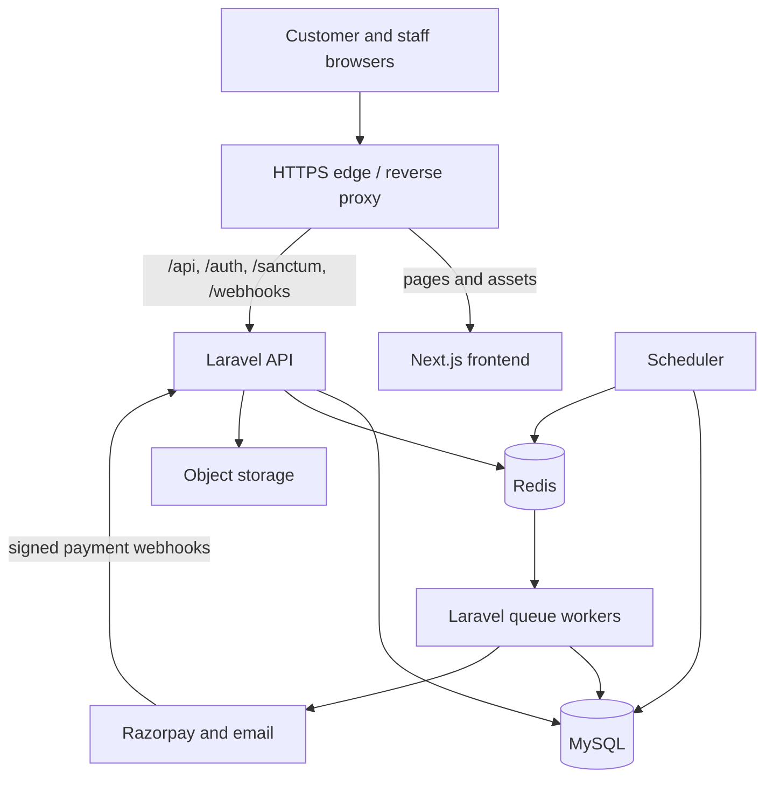
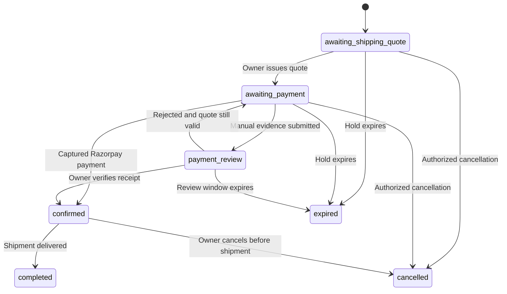

# Auraflare — Architecture and data design

Version 1.0 • 19 October 2026 • Status: proposed implementation baseline

## 1. Executive decision

Build a Laravel modular monolith with a Next.js/TypeScript frontend in one Git repository. Use one relational database, one inventory authority and one payment orchestration layer. Next.js serves the public storefront and protected admin route groups; Laravel owns authentication, authorization, catalogue, stock, orders, pricing, payments and publishing. Deploy the frontend and API independently from the same reviewed commit. Do not introduce microservices, Kubernetes, a generic repository layer, event sourcing, GraphQL or multiple databases for this launch.

Laravel 13 + PHP 8.5 is the proposed greenfield baseline. Laravel's published support table lists PHP 8.3–8.5 for Laravel 13. Confirm all selected package versions in M0 and commit Composer and JavaScript lockfiles. Use MySQL and Redis on maintained releases compatible with the chosen hosting; pin exact container versions/digests in M0. Next.js App Router supports indexable product/collection pages; use client components for the cart, dialogs, checkout, payment widget and admin. Do not add a second React/Vite app until independent admin deployment provides a concrete benefit.

## 2. Confirmed scope versus proposed defaults

| Topic | Decision | Status |
|---|---|---|
| Existing application | Design prototypes only; build production application fresh | Confirmed |
| Geography/currency | Selected Indian cities/states; INR | Confirmed; exact delivery list pending |
| Customer access | Guest checkout plus optional accounts | Confirmed |
| Shipping | Owner confirms delivery charges before requesting payment | Confirmed |
| Payments | Razorpay and manual payment with owner verification | Confirmed |
| Availability | Ready stock only; no purchase when sold out | Confirmed |
| Roles | Owners and staff with different permissions | Confirmed in design brief |
| Operations | Catalogue, photos, variants, stock alerts, orders, shipping, enquiries, content, team, profile/password/avatar | Confirmed in design reference |
| Deployment | One monorepo, two deployable apps; same-origin routing | Proposed |
| Customer login | Email/password, verified email; no SMS OTP in v1 | Proposed |
| Order communications | Transactional email; manual channels can share secure payment page | Proposed; provider pending |
| Review/payment holds | 24h review; 24h payment window from quote; 48h manual-review window from submission | Proposed configurable defaults |
| Tax | Versioned server-side tax policy; actual registrations/rates/invoice wording must be supplied | Unresolved launch input |
| Shipping/returns/refunds | Manual shipment entries; full-order refunds first; no automated courier integration | Proposed v1 scope |

The reviewed ZIP snapshots contain illustrative catalogue records and simulated authentication/checkout. Never import sample prices, inventory, claims or customer records as real business data. Latest font refinements after the exported storefront snapshot may need separate visual confirmation; this plan does not change the design.

## 3. Deployment topology



Use an owned domain with host-only secure session cookies. Example routing is conceptual, not an existing domain: `https://shop.example.test` serves pages including `/admin`; edge sends Laravel prefixes to PHP-FPM/Nginx. Deploy the same routing model locally and in staging. CDN/cache bypass all authentication, cart, order, admin and payment endpoints. Only public catalogue/content may be cached. An admin URL is not a security boundary: Laravel checks staff membership and permissions on every request.

Use one API service image for HTTP, queue workers and scheduled tasks, with separate processes. Start with one appropriately sized host or managed services; size from measured traffic, not invented volume. Persist the database and uploads outside containers; use managed backups or an equivalent tested backup process.

## 4. Laravel module boundaries

| Module | Owns | Dependencies |
|---|---|---|
| Identity | Users, verification, sessions, invitations, staff membership, capabilities, profiles | Media for avatars; Notifications |
| Catalog | Products, variant SKUs/options, prices, collections, public projections | Media |
| Inventory | Balances, holds, immutable movement ledger, low-stock thresholds | Catalog identifiers |
| Commerce | Carts, order requests, order snapshots, shipping quotes, transitions | Catalog, Inventory, Delivery, Tax |
| Payments | Attempts, Razorpay orders, webhook inbox, manual evidence, refunds, reconciliation | Commerce public actions; provider adapter |
| Fulfillment | Packing, shipment and delivery records | Paid Commerce orders |
| Delivery | Serviceability rules and explicit postcode exceptions | No external courier in v1 |
| Content | Draft/published home content and revisions | Catalog, Media |
| Enquiries | Public enquiries, source, notes, assigned staff, status | Identity identifiers |
| Media | Upload validation, private proofs, public product images and derivatives | Object storage |
| Reporting | Dashboard projections and export jobs | Read-only queries across modules |
| Audit/Notifications | Audit records; transactional outbox and delivery records | Cross-cutting primitives |

Keep controllers thin: FormRequest → authorization policy → typed DTO → action → API Resource. An action represents one business use case (`IssueShippingQuote`, `VerifyManualPayment`). Use Eloquent directly in actions/query objects; add interfaces only at replaceable boundaries such as Razorpay, mail and storage. Write explicit orchestrating actions for cross-module transactions. Do not hide stock mutation in model observers. Domain events describe completed outcomes and run side effects after commit through an outbox.

## 5. Repository and directory structure

```text
auraflare/
  AGENTS.md
  README.md
  Makefile
  compose.yaml
  .github/workflows/{api,web,contract,release}.yml
  apps/
    api/
      app/
        Modules/
          Identity/{Actions,Data,Enums,Models,Policies,Http,Jobs}/
          Catalog/{Actions,Data,Enums,Models,Policies,Queries,Http}/
          Inventory/{Actions,Data,Enums,Models,Policies,Jobs,Http}/
          Commerce/
            Actions/{SubmitOrderRequest,IssueShippingQuote,CancelOrder}.php
            Data/{SubmitOrderData,OrderLineData,ShippingQuoteData}.php
            Enums/{OrderStatus,PaymentStatus,FulfillmentStatus}.php
            Models/{Cart,CartItem,Order,OrderItem,ShippingQuote}.php
            Policies/OrderPolicy.php
            Queries/OrderListQuery.php
            Http/
              Controllers/{Storefront,Admin}/
              Requests/{SubmitOrderRequest,IssueShippingQuoteRequest}.php
              Resources/{OrderResource,OrderSummaryResource}.php
          Payments/{Actions,Contracts,Data,Enums,Models,Jobs,Http,Providers}/
          Fulfillment/{Actions,Models,Policies,Http}/
          Delivery/{Actions,Models,Http}/
          Content/{Actions,Models,Policies,Http}/
          Enquiries/{Actions,Models,Policies,Http}/
          Media/{Actions,Models,Policies,Http}/
          Reporting/{Queries,Jobs,Http}/
        Support/{Money,Clock,Idempotency,Audit,Outbox}/
        Providers/{AppServiceProvider,ModuleServiceProvider}.php
      bootstrap/app.php
      routes/{api,auth,webhooks,console}.php
      config/{auraflare,payments,inventory,delivery}.php
      database/{migrations,factories,seeders}/
      tests/{Unit,Feature,Integration,Contract}/
      composer.json
      composer.lock
      Dockerfile
    web/
      src/
        app/
          (storefront)/{page,layout}.tsx
          (storefront)/products/[slug]/page.tsx
          (storefront)/collections/[slug]/page.tsx
          (storefront)/{cart,checkout,account}/
          (storefront)/orders/[orderId]/page.tsx
          (auth)/{login,register,forgot-password,reset-password}/
          admin/{layout,page}.tsx
          admin/{orders,products,inventory,enquiries,content,team,profile}/
        features/{catalog,cart,checkout,orders,payments,auth,admin}/
        components/{ui,brand,forms}/
        lib/{api,auth,query,money,validation}/
        styles/{tokens,globals}.css
        mocks/{handlers,fixtures}/
      public/
      tests/{unit,e2e}/
      package.json
      Dockerfile
  packages/
    api-client/{src,package.json}/
    design-tokens/
  contracts/{openapi.yaml,examples}/
  docs/{architecture,decisions,runbooks}/
  design-reference/{README.md}/
  infrastructure/{nginx,containers,deploy}/
  package.json
  pnpm-workspace.yaml
  pnpm-lock.yaml
```

These paths are proposed files, not existing application code. Create module subfolders only when used. Register route files, policy mappings, model factories and providers explicitly so nonstandard model paths work. Keep migrations in Laravel's normal central folder with globally unique timestamps. `packages/api-client` is generated from `contracts/openapi.yaml`; never hand-edit generated types. Do not create an npm backend wrapper; PHP dependencies remain Composer-owned. Use a simple pnpm workspace; add task orchestration only if build time warrants it.

## 6. Core relational model

Use internal bigint primary keys and unique ULID `public_id` values exposed as API IDs. FK columns use internal keys. This is a proposal chosen for straightforward Laravel/MySQL support, not a requirement to use binary UUIDs. Store UTC timestamps; render/report in Asia/Kolkata. All monetary values are integer paise, currency fixed to INR. Never use floating point for totals.

| Tables | Key data and constraints |
|---|---|
| users | public_id, unique normalized email, password hash, email_verified_at, name, phone, bio, avatar_media_id, active |
| staff_memberships | unique user_id, role owner/fulfillment, active; optional explicit approved capabilities later |
| invitations | normalized email, role, token_hash, expires_at, accepted_at, invited_by; no plaintext token |
| sessions / password_reset_tokens | Laravel session and recovery persistence |
| customer_addresses | user_id, address fields; authorization scoped to owner |
| products | public_id, unique slug, title, description, scent_notes, status draft/active/archived, version |
| product_variants | product_id, unique SKU, normalized option combination hash unique per product, price_minor, currency, active, version |
| variant_options | variant_id, option_name, option_value; unique (variant_id, option_name) |
| collections / collection_product | collection slug/title/status; unique association and sort position |
| media / product_media | storage key, purpose, owner, MIME, byte size, lifecycle; image association/alt/order |
| inventory_balances | unique variant_id, on_hand, reserved, low_stock_threshold, version; nonnegative, reserved ≤ on_hand |
| stock_reservations / reservation_items | order_id unique reservation; status active/consumed/released, expires_at; quantities per variant |
| inventory_movements | variant_id, signed on_hand_delta, signed reserved_delta, reason, actor/order refs, unique effect_key |
| carts / cart_items | opaque guest cart cookie hash or user_id; cart version; unique (cart_id, variant_id); no stock holds |
| delivery_rules | kind state/city/postcode, canonical location fields, allow/deny, active, priority; postcode deny wins |
| orders | public_id, unique display number, user_id nullable, source website/whatsapp/instagram/phone, contact/address snapshots, status, payment_status, fulfillment_status, subtotal/tax/shipping/total_minor, version, policy snapshots |
| order_items | product/variant refs, SKU/title/options/unit-price/tax snapshots, quantity, line_total_minor; immutable after submission |
| shipping_quotes | order_id, version unique per order, amount_minor, total_minor, expires_at, issued_by, accepted_at, status; one current quote |
| payment_attempts | order_id, quote_id, method, amount/currency, provider_order_id unique nullable, provider_payment_id unique nullable, status, failure_code; multiple attempts per order allowed |
| manual_payment_evidence | attempt_id, reference, evidence_media_id nullable, submitted_at, status, reviewed_by/time, review_reason; normalized bank reference uniqueness when verified |
| refunds | payment_attempt_id, amount_minor, provider_ref unique nullable, state requested/processing/succeeded/failed, reason, idempotency key |
| webhook_events | provider, event_id unique together, payload/raw-body retention, payload_hash, received/processed status, retry metadata |
| shipments | order_id unique in v1, carrier, tracking_number/url, shipped_at, delivered_at, actor |
| enquiries / enquiry_notes | contact/source/product/event details/status/assignee; internal notes separate from public data |
| content_revisions | unique page/revision, schema-versioned JSON blocks, draft/published state, actor and published_at; transactional current pointer |
| audit_logs | actor, action, entity, redacted changes, request_id, created_at; append-only |
| idempotency_records | scope, key, payload_hash, state, response, expires_at; unique(scope,key) |
| outbox_messages / notification_deliveries | business effect key unique, payload, status, retries, sent_at |
| export_jobs | requester, filters, state, private file key, expiry |

Indexes: orders(status, created_at), orders(user_id, created_at), orders(payment_status, created_at); reservations(status, expires_at); variants(product_id, active); products(status, slug); webhook_events(status, received_at); enquiries(status, created_at); payment_attempts(status, updated_at); audit_logs(entity_type, entity_id, created_at). Enforce unique external identifiers and effect keys in the DB, not only application validation.

Archive catalogue entries referenced by orders; do not cascade-delete order/payment history. Soft deletion is not a substitute for retention rules. Separate product public projections from admin records. Never expose procurement notes, proof files, customer addresses or payment payloads through catalogue responses.

## 7. Order request, quote and payment workflow

1. Cart is advisory and never reserves stock. API recalculates current price/availability and serviceability before submission. If a displayed price changed, return `409 PRICE_CHANGED` with a fresh cart; require customer review rather than silently charging a higher price.
2. `Submit order request` creates the order and snapshot lines, reserves stock atomically, and returns `awaiting_shipping_quote`. Show “Delivery charge pending owner confirmation; no payment taken.” The product subtotal is not presented as the final payable amount. Address must fall within configured serviceability rules; missing rules fail closed.
3. Owner reviews the request and issues a versioned shipping quote. Server calculates tax and final total from configured policy. Customer receives a secure page with item subtotal, delivery, tax breakdown, final total and expiry. State becomes `awaiting_payment`. Only the owner may issue financial quotes in v1; fulfillment staff can flag review work.
4. Customer explicitly accepts the current quote as part of payment initiation or manual-payment submission. Store accepted quote version and time. No Razorpay order is created before this step. Address/items cannot be edited after submission; cancel and recreate while unpaid.
5. Razorpay flow creates an internal attempt first, then a provider order outside the DB transaction using the exact accepted total and INR. Browser loads Checkout with provider order and public key. Browser success invokes server verification, which verifies the signature and fetches provider payment details. Only a verified captured payment for the expected provider order/amount/currency can settle the order. Webhook and periodic reconciliation are independent recovery paths.
6. Manual flow displays configured payment instructions after quote acceptance. Customer submits reference and optional private proof; state becomes `under_review`. Only the owner records approval after checking funds against the bank/payment account. A screenshot or customer claim never marks an order paid. Reject with a reason and offer another valid payment attempt if the quote/hold is still current.
7. Settlement consumes the hold: decrease on_hand and reserved by quantity, write one ledger effect and mark paid/confirmed in a single transaction. Packing and shipping are enabled only after settlement. Owner/staff record dispatch and delivery; there is no automated courier integration in v1.



States are separate axes. Order status: `awaiting_shipping_quote, awaiting_payment, payment_review, confirmed, completed, cancelled, expired`. Payment status: `unpaid, pending, under_review, paid, refund_pending, refunded, failed, exception`. Fulfillment: `unfulfilled, packing, shipped, delivered, cancelled`. Return explicit `allowed_actions` based on policy and state. No generic “update status” endpoint; transitions are named commands. A late payment on an expired/cancelled order sets payment status `exception` while retaining the order state and creates an owner task. No automatic fulfillment or silent stock resurrection.

### Holds, race conditions and retries

- Proposed hold deadlines: 24h after request submission; on first quote issue, extend to 24h after issue. Limit one automatic quote extension; subsequent extensions are explicit owner actions with audit reason. Manual evidence within a valid hold extends it to 48h from submission for owner review. These windows require owner review before launch; expose deadlines in the UI.
- On every checkout/reservation command, treat expired holds as expired even if scheduler execution is late. Scheduler sweeps every minute; lazy cleanup on relevant variant rows prevents stale availability. Lock variant balances in sorted ID order, then lock/update order and reservation in a consistent documented order across actions. Retry deadlocks a bounded number of times.
- `available = on_hand - reserved`. Reserve with a transaction and `SELECT ... FOR UPDATE` or conditional atomic update checked for affected rows. Duplicate variant lines must be aggregated before checking stock. Never rely on Redis locks as the only stock correctness mechanism.
- Consume/release effects have unique keys per reservation and effect type. Expiry, cancellation and payment settlement must take the same locks and check current state. Concurrent payment and expiry has exactly one winner; late capture becomes an exception unless an authorized recovery atomically reacquires all required stock.
- Inventory adjustment cannot reduce on_hand below reserved. Record deltas and reason; no bare PATCH to stock quantity. Low stock is computed on available quantity and emits deduplicated alerts on threshold crossings.
- Quote reissue supersedes previous quotes. Do not reprice while a provider attempt or manual review is unresolved; require reconciliation/closure first. An old provider payment is reconciled against its immutable attempt total, then routed to exception handling if quote/order no longer permits settlement.
- Disable payment-method switching while an unresolved attempt exists. Expiry does not make an external gateway incapable of receiving money: reconcile late events. Any excess second captured payment is an owner-visible exception/refund case; never consume stock twice.
- Provider calls occur outside DB locks. A timeout after create-order is an `unknown` attempt; reconcile using the internal reference/receipt before creating another provider order. Browser Idempotency-Key does not guarantee provider-side exactly-once execution. Crash recovery inspects pending attempts and uses provider identifiers/reference lookup supported by the selected API.
- Rate-limit order requests by session/email/IP and cap outstanding unpaid reservations. Apply bot controls on suspicious traffic; otherwise guests could lock all available inventory without payment.

### Cancellations and refunds

Customers may cancel only their own unpaid order without an unresolved payment attempt. After payment, owner handles cancellation and a full-order refund. Before shipment, cancellation can restock goods in a separate exactly-once ledger operation; refund completion alone never restocks. After shipment, returns/restocking require physical verification and owner action, outside automatic v1 workflow. Razorpay refunds settle only after verified provider outcome. Manual-payment refunds require owner-recorded bank reference and confirmation. Refund retries retain a single refund operation reference and reconcile ambiguous outcomes. Partial refunds, exchanges and self-service returns are deferred.

## 8. Authentication and permissions

Use Sanctum first-party cookie sessions and Laravel authentication services/Fortify where compatible. Bootstrap CSRF with `GET /sanctum/csrf-cookie`, send credentials and X-XSRF-TOKEN for mutations. Session cookie HttpOnly, Secure, host-only, SameSite=Lax; the XSRF cookie is intentionally JS-readable. Regenerate session on login; invalidate on logout. Do not store passwords or bearer tokens in localStorage. Public catalogue SSR fetches only public data; account/admin data uses client fetch with credentials or explicit request-scoped server credential forwarding and `no-store`.

One user identity may have a customer account and a staff membership. Registration creates customer access only. Login never accepts a role. Staff membership is checked fresh on every admin request so deactivation/revocation applies immediately, and deactivation revokes active sessions. Require verified email for customer order claiming and staff activation. Password changes verify current password, use Laravel hashing and revoke other sessions. Reset/verification/invitation endpoints use expiring single-use hashed tokens, throttles and generic recovery responses. Owner MFA is recommended for launch using a maintained implementation; if adopted, add challenge/enrollment operations to contract before M1 completion rather than inventing an ad hoc factor scheme.

| Capability | Owner | Fulfillment staff | Customer / guest |
|---|---|---|---|
| Public catalogue/content/enquiry submission | Yes | Yes | Yes |
| Own profile/password/avatar | Yes | Yes | Account holders; guest no profile |
| Product/pricing/collections edits | Yes | No | No |
| View orders / pack / ship / stock adjustments | Yes | Yes | Own order read only |
| Shipping quotes / payment verification / refunds | Yes | No | Accept/pay own valid quote |
| Enquiry notes/assignment/status | Yes | Yes | Submit only |
| Content publish / delivery rules / team | Yes | No | No |
| Revenue dashboard / exports / audit | Yes | No | No |
| Operational overview / low-stock list | Yes | Yes | No |

Protect the final active owner transactionally with locking across owner-membership mutations. Invitations cannot overwrite an existing user's password or silently grant privilege. Acceptance requires verified control of the invited email; existing users authenticate before accepting. Bootstrap first owner through an interactive deployment CLI, no default credentials or public owner-registration endpoint.

### Guest order access and account association

Use opaque, random, order-scoped guest grants (at least 256 bits; hashes stored server-side). Initial submission grants access only to that browser's order via HttpOnly guest session. Transactional email carries a short-lived one-time token in a URL fragment; the page exchanges it through POST, strips it from browser history, and receives an HttpOnly scoped guest session. No PII or credentials in query strings/logs; payment pages use no third-party analytics, `Referrer-Policy: no-referrer`, no-store and noindex. Grant expiry/revocation and token replay tests are required. Access is established before fetching order details; never return an order merely from its number and email. Account claiming requires authenticated verified email matching the order email and an explicit claim action; do not associate arbitrary orders based on a typed email.

## 9. Media, content and reporting

Product images: JPEG/PNG/WebP, proposed 10 MB original limit; avatar 2 MB; manual evidence JPEG/PNG/PDF up to 5 MB. Validate decoded content, MIME and dimensions, reject executable/SVG uploads, strip image metadata, generate bounded variants asynchronously, and use unpredictable keys. Proofs stay on a private disk with short-lived authorized download; scan PDFs before staff access. Product images are published only after ready state and ownership checks. Quarantine/orphan cleanup must not delete referenced media. Publish content revisions atomically; validate references and invalidate public cache only after commit. Published content is returned by version; failed invalidation has a bounded public-cache TTL fallback. Draft previews are owner-only and noindex.

Dashboard revenue means captured/verified receipts minus successful refunds during the requested period, shown with its definition; unpaid requests are excluded. Order counts report request creation period separately. Define timezone conversion at boundaries and test midnight. CSV exports are owner-only, asynchronous, private, expiring and neutralize spreadsheet formula prefixes. Avoid writing PII and payment evidence to logs.

## 10. Source basis and limitations

Reviewed current files: `Auraflare-Admin-Codex-Reference.zip` (README and Codex prompt) and `Auraflare-Design-Codex-Reference.zip` (README and Codex prompt). These establish interface scope and prototype boundaries, not production behaviour. Full visual fidelity must be verified against HTML/CSS/assets during frontend implementation.

Official technical references checked 19 October 2026:

- Laravel release/support policy: https://laravel.com/docs/13.x/releases
- Sanctum session and SPA authentication: https://laravel.com/docs/13.x/sanctum
- Next.js Server/Client Components: https://nextjs.org/docs/app/getting-started/server-and-client-components
- Razorpay integration/signature verification: https://razorpay.com/docs/payments/payment-gateway/web-integration/standard/integration-steps/
- Razorpay raw-body signature validation, duplicate events and event ordering: https://razorpay.com/docs/webhooks/validate-test/

Provider documentation supports integration mechanics; stock holds, module boundaries and deployment choices are engineering proposals. Business policies, tax configuration, hosting, notification provider, actual catalogue and delivery allowlist remain launch inputs. This artifact contains no implemented or deployed application.
